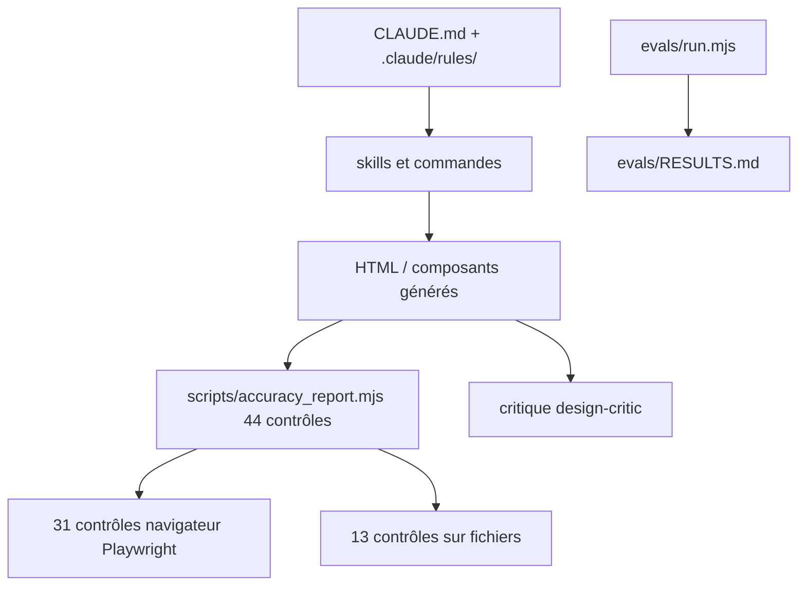

# plugin87/ux-ui-agent-skills

> Layer of instructions and automatic checks that frames the production of interfaces by an agent.

## The problem
An agent left free always produces the same interface: an indigo-violet gradient, four identical cards, emoji as icons, low-contrast gray text.
Nothing objectively distinguishes this result from decent work, so nothing blocks it.

## What it actually does
Provides 19 invocable skills, 5 commands (`/gate`, `/critique`, `/grill-me`, `/ship`, `/scaffold-project`) and a `design-critic` agent, with no build and no runtime dependency.
Generates tokens in DTCG format on three levels (primitive → semantic → component) and targets any framework through an adapter protocol.
Runs 44 checks: 31 open a real browser and measure the rendered HTML (WCAG contrast light and dark, default/hover/focus states, axe-core, focus traps, RTL, target size, reduced motion), 13 read files.
`/critique` renders the page, clicks the controls and argues for rejection: it judges, it does not score.

## How it is wired


## Trying it
```bash
npx ux-ui-agent-skills demo
npx ux-ui-agent-skills init
npm install
npx playwright install chrome
node scripts/accuracy_report.mjs
```

## Cost and gotchas
Without an installed browser, 31 checks out of 44 report `REQUIRED, FAILING`; run alone they display `SKIPPED` and exit with code 0, hence `DS_REQUIRE_BROWSER=1` if you read the exit code.
Playwright is installed neither by `/plugin install` nor by `npx … init`.

## What it is not
A score of 44/44 measures correctness, not quality: the README says so, and two pages passing the 14 eval checks were sent back to "rework" by the critic.
Framework components (`.tsx`, `.vue`, `.swift`) are reached only by the checks that read files, never by a render — a named limit, not hidden.
`lint_intent_source` proves a declaration of intent, never a color.

## Alternatives
No alternative named in the README.

## For you
If you have an agent produce interfaces, it is the only measurable safeguard of the batch; the undeclared license remains to be resolved before professional use.
