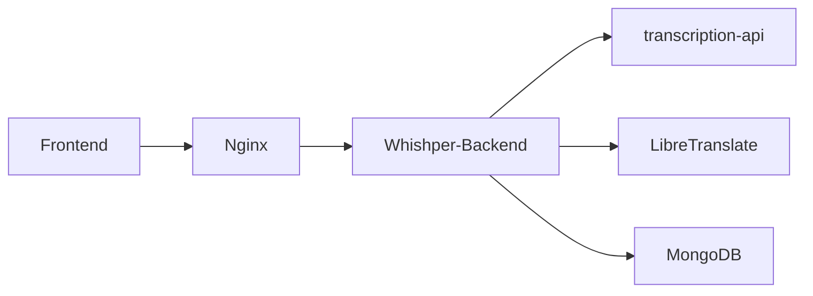

# pluja/whishper

> Local web app for transcription and subtitling with FasterWhisper, for those who want to keep everything on their own machine.

## The problem
Transcribing, translating and correcting subtitles forces you to chain cloud services or separate tools, sending your media to third parties.

## What it actually does
Transcribes audio and video (uploaded file or URL via yt-dlp) with FasterWhisper, exports to TXT, JSON, VTT, SRT, translates via LibreTranslate, and offers a subtitle editor (highlighting, characters-per-second warnings, splitting and inserting segments). Runs on CPU or NVIDIA GPU, claimed to work offline.

## How it is wired

## Trying it
The supplied README contains no command: it points to a quick-start script and external documentation, not reproduced here.

## Cost and gotchas
Free, but six containers to run (including MongoDB and LibreTranslate). An NVIDIA GPU speeds things up considerably, otherwise CPU is slower.

## What it is not
Not a library: it is a complete application to host. The README gives neither transcription accuracy nor a benchmark.

## Alternatives
No alternative named; it relies on Faster Whisper and LibreTranslate.

## For you
Watch: handy for local transcription, but a heavy stack and a single maintainer for a production component.
