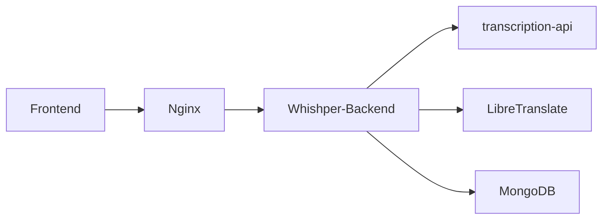

# pluja/whishper

> Application web locale de transcription et sous-titrage avec FasterWhisper, pour qui veut tout garder sur sa machine.

## Le problème
Transcrire, traduire et corriger des sous-titres oblige à enchaîner des services cloud ou des outils séparés, avec envoi de ses médias à des tiers.

## Ce que ça fait vraiment
Transcrit audio et vidéo (fichier envoyé ou URL via yt-dlp) avec FasterWhisper, exporte en TXT, JSON, VTT, SRT, traduit via LibreTranslate, et propose un éditeur de sous-titres (surlignage, alertes de caractères par seconde, découpe et insertion de segments). Tourne sur CPU ou GPU NVIDIA, annoncé fonctionnel hors ligne.

## Comment c'est branché

## Essayer
Le README fourni ne contient aucune commande : il renvoie à un script de démarrage rapide et à une documentation externe, non reproduits ici.

## Coût et pièges
Gratuit, mais six conteneurs à faire tourner (dont MongoDB et LibreTranslate). Un GPU NVIDIA accélère nettement, sinon CPU plus lent.

## Ce que ce n'est pas
Ce n'est pas une bibliothèque : c'est une application complète à héberger. Le README ne donne ni précision de transcription ni benchmark.

## Alternatives
Aucune alternative nommée ; il s'appuie sur Faster Whisper et LibreTranslate.

## Pour toi
Surveiller : pratique pour de la transcription locale, mais pile lourde et mainteneur unique pour une brique de production.

