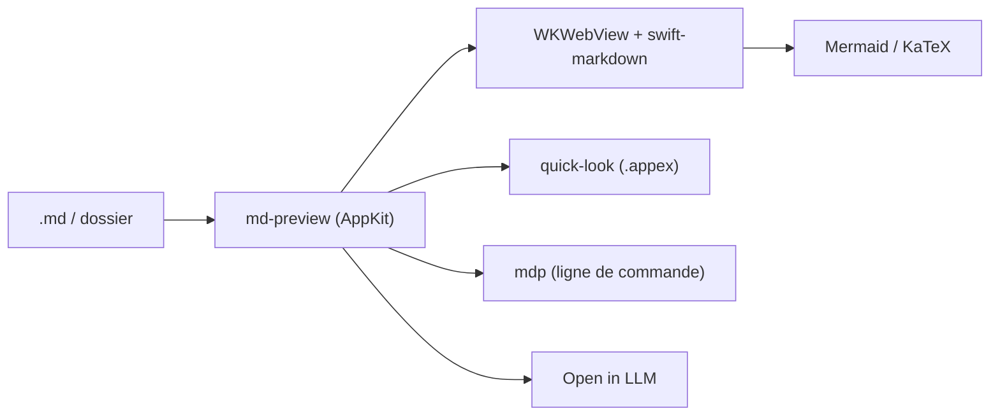

# pluk-inc/markdown-preview

> Native macOS app for reading and editing Markdown files, with outline, Mermaid and formulas.

## The problem
Reading a `.md` requires an editor or a browser tab, with no navigable outline and no diagram rendering.

## What it actually does
WKWebView rendering from swift-markdown, side outline, file browser, search, edit mode (⌘E). Mermaid and KaTeX are bundled, so it works offline. Quick Look extension for the space bar in Finder, `mdp` commands and the `md-preview://` URL scheme. "Open in LLM" buttons for Codex, Claude or ChatGPT.

## How it is wired


## Trying it
```bash
brew install --cask markdown-preview
mdp README.md
```

## Cost and gotchas
Free. macOS 15 minimum. Telemetry: crash reports via Sentry and one anonymous daily usage event via PostHog, which can be disabled in Settings > Privacy. Updates via Sparkle.

## What it is not
Not cross-platform nor a note manager. Editing remains basic, with a formatting toolbar. The mention of the MIT license comes from the catalog, not from the README text.

## Alternatives
No alternative named in the README (VS Code, Cursor and Zed are only mentioned as "Open With" editors).

## For you
Ignore: a macOS viewer unrelated to your stack, while a common Markdown editor on Linux or WSL covers the need.
