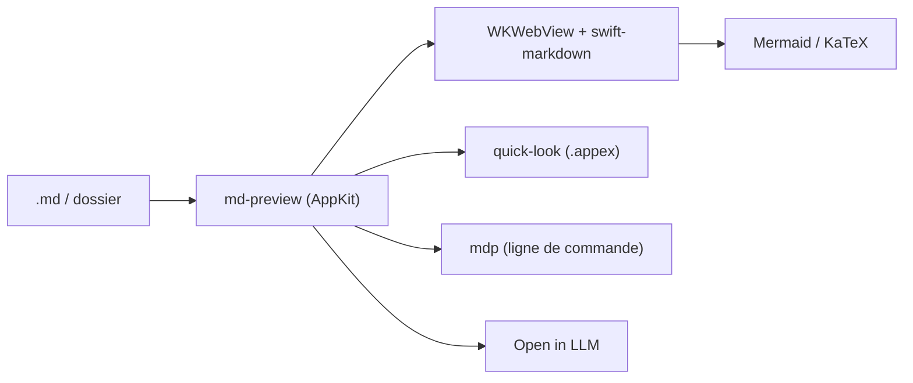

# pluk-inc/markdown-preview

> Application macOS native pour lire et éditer des fichiers Markdown, avec plan, Mermaid et formules.

## Le problème
Lire un `.md` demande un éditeur ou un onglet de navigateur, sans plan navigable ni rendu des diagrammes.

## Ce que ça fait vraiment
Rendu WKWebView à partir de swift-markdown, plan latéral, navigateur de fichiers, recherche, mode édition (⌘E). Mermaid et KaTeX embarqués, donc hors ligne. Extension Quick Look pour l'espace dans le Finder, commandes `mdp` et schéma d'URL `md-preview://`. Boutons « Open in LLM » vers Codex, Claude ou ChatGPT.

## Comment c'est branché


## Essayer
```bash
brew install --cask markdown-preview
mdp README.md
```

## Coût et pièges
Gratuit. macOS 15 minimum. Télémétrie : rapports de crash via Sentry et un événement d'usage quotidien anonyme via PostHog, désactivables dans Réglages > Confidentialité. Mises à jour via Sparkle.

## Ce que ce n'est pas
Pas multiplateforme ni un gestionnaire de notes. L'édition reste basique, avec une barre d'outils de formatage. La mention de la licence MIT vient du catalogue, pas du texte du README.

## Alternatives
Aucune alternative nommée dans le README (VS Code, Cursor et Zed ne sont cités que comme éditeurs « Open With »).

## Pour toi
À ignorer : visionneuse macOS sans lien avec ta pile, alors qu'un éditeur Markdown courant sous Linux ou WSL couvre le besoin.

