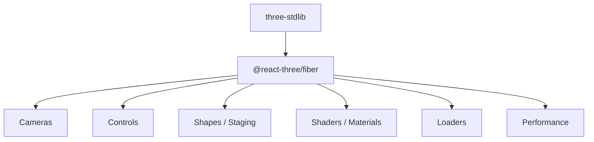

# pmndrs/drei

> Collection of ready-to-use helpers and abstractions for @react-three/fiber, for React developers doing web 3D.

## The problem
Writing 3D with three.js in React requires a lot of repetitive code: cameras, controls, loaders, shadows, materials.

## What it actually does
Provides components and hooks grouped into families: cameras, controls, gizmos, shapes, abstractions (Text, Html, Image…), shaders, loaders (useGLTF, useTexture…), performance (Instances, Bvh, AdaptiveDpr), portals and staging (Environment, Stage, ContactShadows). A `native` version exists for React Native, without `Html` or `Loader`. Detailed documentation is hosted separately.

## How it is wired


## Trying it
```bash
npm install @react-three/drei
yarn install
yarn build
yarn test
```

## Cost and gotchas
Free. Visual tests depend on Playwright and system-specific snapshots: the README recommends Docker to reproduce CI. The package uses `three-stdlib` rather than `three/examples/jsm`.

## What it is not
Not a standalone 3D engine: it assumes React, three.js and @react-three/fiber. The README itself is now just an index pointing to a documentation site.

## Alternatives
No alternative named in the README.

## For you
Watch: useful only if you build interactive 3D visualizations (model demos, digital twins) in React; without that need, it adds nothing to a data/AI workflow.
