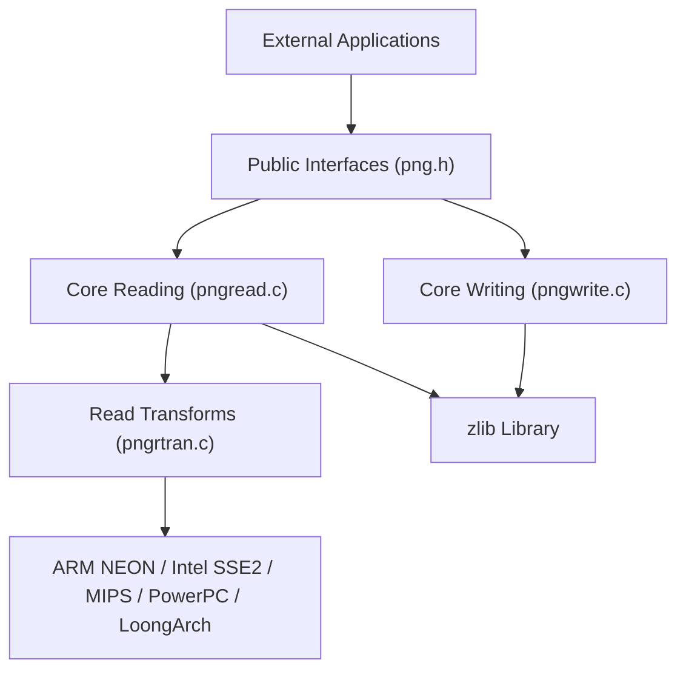

# pnggroup/libpng

> Reference C library for reading and writing PNG images, in use since 1995.

## The problem
Every program handling PNGs would otherwise have to reimplement the format: chunks, filters, zlib compression, color depths.

## What it actually does
Provides a C API (png.h) to read, write and transform PNGs, including in progressive mode. Relies on zlib for compression. Contains optimizations for ARM Neon, Intel SSE2, MIPS, PowerPC, LoongArch and RISC-V. The repository brings examples (example.c, pngtest.c), test image sets and build scripts.

## How it is wired
Diagram based on the one provided, simplified.

## Trying it
No command in the README: it points to the INSTALL file, libpng-manual.txt, example.c and pngtest.c.

## Cost and gotchas
Free. The license is present but not identified by GitHub: re-read it in LICENSE.md. Requires zlib 1.0.4 or later. The README describes the 1.8.0.git branch, yet the public API has been stable since 1.0.

## What it is not
Not a command-line tool nor a "turnkey" decoder: it is a C library to link into a program.

## Alternatives
No alternative named in the README.

## For you
Ignore as a direct dependency: you already use it through Pillow, OpenCV or your browsers, without having to handle it.
