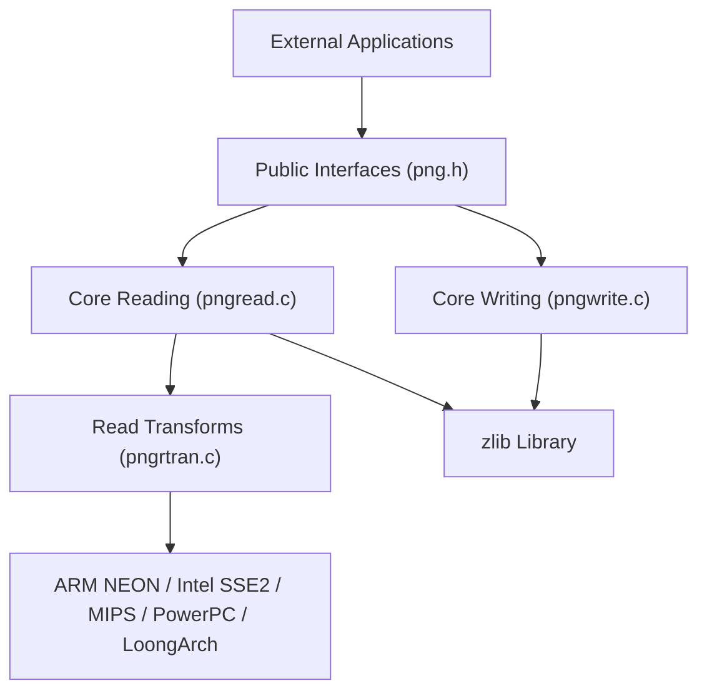

# pnggroup/libpng

> Bibliothèque C de référence pour lire et écrire des images PNG, utilisée depuis 1995.

## Le problème
Chaque programme qui manipule des PNG devrait sinon réimplémenter le format : chunks, filtres, compression zlib, profondeurs de couleur.

## Ce que ça fait vraiment
Fournit une API C (png.h) pour lire, écrire et transformer des PNG, y compris en mode progressif. S'appuie sur zlib pour la compression. Contient des optimisations pour ARM Neon, Intel SSE2, MIPS, PowerPC, LoongArch et RISC-V. Le dépôt apporte exemples (example.c, pngtest.c), jeux d'images de test et scripts de build.

## Comment c'est branché
Schéma d'après le diagramme fourni, simplifié.

## Essayer
Aucune commande dans le README : il renvoie au fichier INSTALL, à libpng-manual.txt, à example.c et pngtest.c.

## Coût et pièges
Gratuit. La licence est présente mais non identifiée par GitHub : à relire dans LICENSE.md. Nécessite zlib 1.0.4 ou plus. Le README décrit la branche 1.8.0.git, l'API publique est toutefois stable depuis la 1.0.

## Ce que ce n'est pas
Pas un outil en ligne de commande ni un décodeur « clé en main » : c'est une bibliothèque C à lier dans un programme.

## Alternatives
Aucune alternative nommée dans le README.

## Pour toi
À ignorer en direct : tu l'utilises déjà via Pillow, OpenCV ou tes navigateurs, sans avoir à la manipuler.

