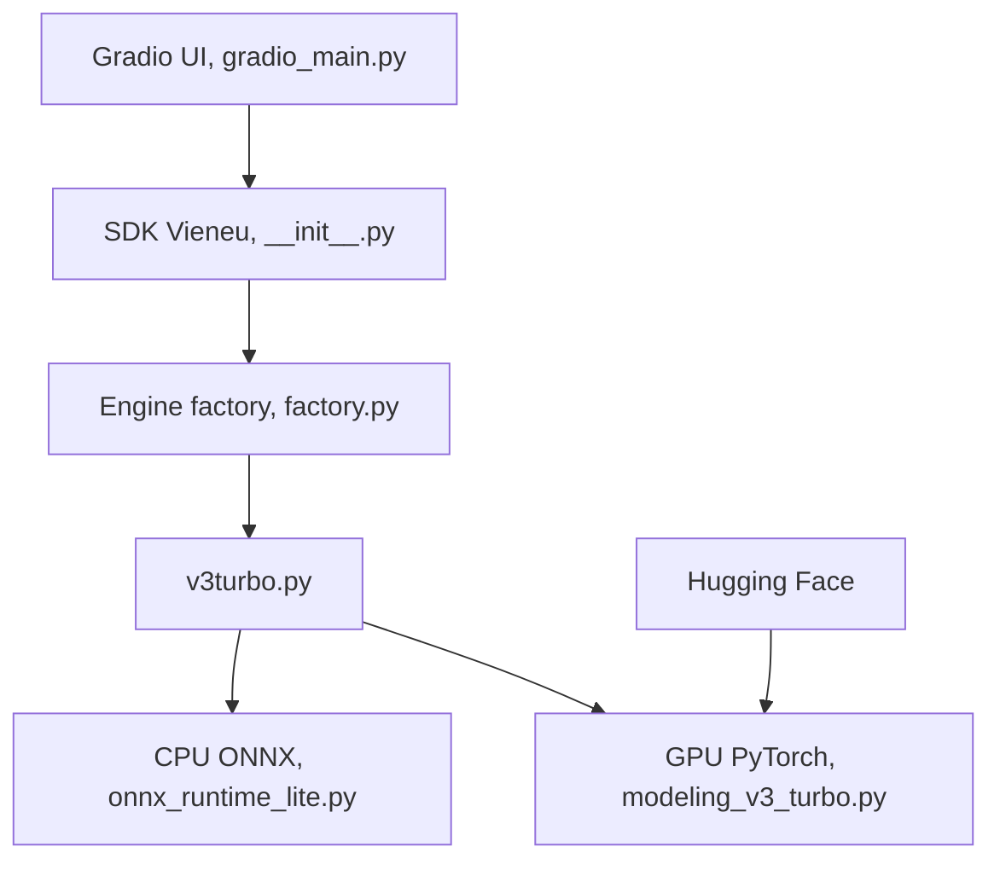

# pnnbao97/VieNeu-TTS

> Local Vietnamese speech synthesis kit, with voice cloning, streaming and an OpenAI-compatible API.

## The problem
Synthetic voices for Vietnamese are rare outside cloud services, and cloning requires heavy models.

## What it actually does
The `vieneu` SDK loads the v3 Turbo model by default (48 kHz, 25 built-in voices, cloning from 3 to 8 seconds of audio). On CPU it runs through ONNX Runtime without PyTorch; on a CUDA GPU it runs through PyTorch with batch processing. An OpenAI-compatible `POST /v1/audio/speech` server, a Gradio interface and LoRA fine-tuning are provided.

## How it is wired


## Trying it
```bash
pip install vieneu
uv sync
uv run vieneu-web
uv run python -m apps.openai_speech
```

## Cost and gotchas
Free; a CPU is enough (RTF about 0.5), an NVIDIA GPU is recommended for throughput. The v4 model, which is more faithful, is proprietary and reserved for the vieneu.io API. The weights come from Hugging Face.

## What it is not
Not a general multilingual model: it targets Vietnamese and English. Nano mode is faster but of clearly lower quality. Dubbing and audiobook are reserved for the official application.

## Alternatives
No alternative named in the README.

## For you
Worth watching: a good example of TTS deployment on CPU and GPU with an OpenAI API, useful only if Vietnamese is a real need.
