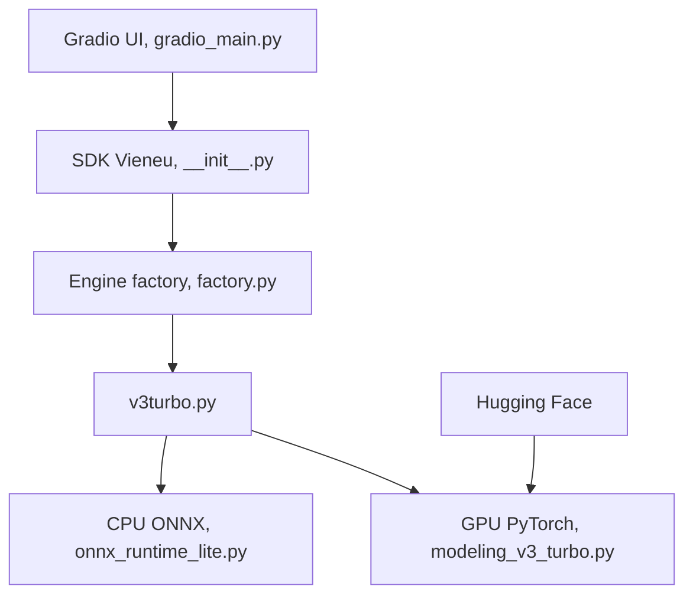

# pnnbao97/VieNeu-TTS

> Kit de synthèse vocale vietnamienne locale, avec clonage de voix, streaming et API compatible OpenAI.

## Le problème
Les voix de synthèse pour le vietnamien sont rares hors des services cloud, et le clonage demande des modèles lourds.

## Ce que ça fait vraiment
Le SDK `vieneu` charge par défaut le modèle v3 Turbo (48 kHz, 25 voix intégrées, clonage à partir de 3 à 8 secondes). Sur CPU il tourne via ONNX Runtime sans PyTorch, sur GPU CUDA via PyTorch avec traitement par lots. Un serveur `POST /v1/audio/speech` compatible OpenAI, une interface Gradio et un fine-tuning LoRA sont fournis.

## Comment c'est branché


## Essayer
```bash
pip install vieneu
uv sync
uv run vieneu-web
uv run python -m apps.openai_speech
```

## Coût et pièges
Gratuit ; CPU suffisant (RTF environ 0,5), GPU NVIDIA conseillé pour le débit. Le modèle v4, plus fidèle, est propriétaire et réservé à l'API vieneu.io. Les poids viennent de Hugging Face.

## Ce que ce n'est pas
Ce n'est pas un modèle multilingue généraliste : il vise le vietnamien et l'anglais. Le mode Nano est plus rapide mais de qualité nettement inférieure. Dubbing et audiobook sont réservés à l'application officielle.

## Alternatives
Aucune alternative nommée dans le README.

## Pour toi
À surveiller : bon exemple de déploiement TTS sur CPU et GPU avec API OpenAI, utile seulement si le vietnamien est un besoin réel.

