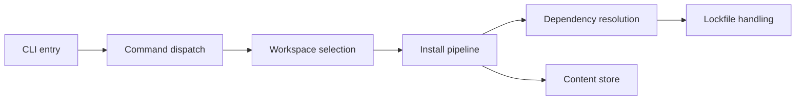

# pnpm/pnpm

> Node.js package manager that shares files through a single store to save disk space.

## The problem
With npm, each project copies its own dependencies; the disk fills up and installs are slow.

## What it actually does
Stores each file only once in a content-addressable store, then links it (hard links or reflinks) into `node_modules`. Strict access to declared dependencies only, `pnpm-lock.yaml` lockfile, monorepo support, Node version management. An experimental Rust port (pacquet) exists.

## How it is wired

## Trying it
No command documented in the README (links to Installation and Usage).

## Cost and gotchas
Free. Strict mode can reveal undeclared dependencies in old projects.

## What it is not
Not a Python manager nor a build tool. The "up to 2x faster" claim comes from the author's own benchmark.

## Alternatives
npm and Yarn: compared in the README; more widespread but without the shared store.

## For you
Worth watching: useful for the Node front ends or tools in your AI projects, irrelevant for pure Python.
