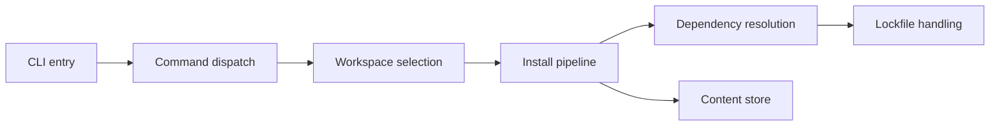

# pnpm/pnpm

> Gestionnaire de paquets Node.js qui partage les fichiers via un stockage unique pour économiser le disque.

## Le problème
Avec npm, chaque projet recopie ses dépendances ; le disque se remplit et les installations sont lentes.

## Ce que ça fait vraiment
Stocke chaque fichier une seule fois dans un magasin adressable par contenu, puis le lie (liens physiques ou reflinks) dans `node_modules`. Accès strict aux seules dépendances déclarées, lockfile `pnpm-lock.yaml`, support des monorepos, gestion des versions de Node. Un portage expérimental en Rust (pacquet) existe.

## Comment c'est branché

## Essayer
Aucune commande documentée dans le README (liens vers Installation et Usage).

## Coût et pièges
Gratuit. Le mode strict peut révéler des dépendances non déclarées dans de vieux projets.

## Ce que ce n'est pas
Pas un gestionnaire Python ni un outil de build. Le « jusqu'à 2x plus rapide » vient d'un benchmark de l'auteur.

## Alternatives
npm et Yarn : comparés dans le README ; plus répandus mais sans le magasin partagé.

## Pour toi
À surveiller : utile pour les fronts ou outils Node de tes projets IA, sans enjeu pour du Python pur.

