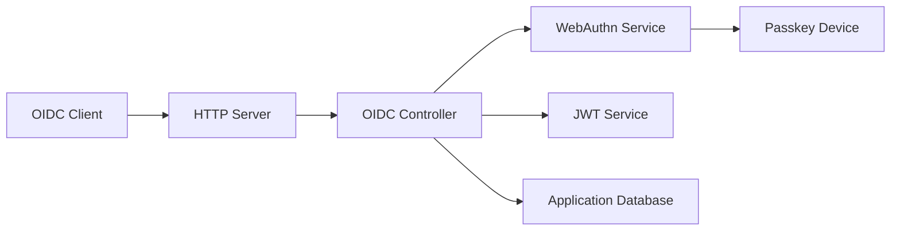

# pocket-id/pocket-id

> Self-hosted OpenID Connect and OAuth 2.0 provider that accepts only passkeys, for homelabs and small teams.

## The problem
Keycloak or ORY Hydra are often too heavy for protecting a few self-hosted services, and passwords are a weak link.

## What it actually does
An OIDC client redirects the user to Pocket ID, which authenticates them by passkey (WebAuthn, for example a YubiKey) then issues tokens. Admin interface for users and clients, API keys, audit logs, email verification, LDAP and SCIM synchronization, configurable database and file storage. OpenID Connect certified according to the README.

## How it is wired

## Trying it
The README contains no command: it points to the documentation for installation, Docker being the recommended route. No command reproduced.

## Cost and gotchas
Free. Everyone must own a passkey-compatible authenticator; no password fallback. Only one apparent maintainer.

## What it is not
Not a full enterprise directory: simpler than Keycloak, with fewer features.

## Alternatives
Keycloak and ORY Hydra, judged too complex for simple cases.

## For you
Adopt it to secure your self-hosted MLOps tools (MLflow, Grafana, notebooks) behind a simple SSO; BSD-2 license, recent activity.
