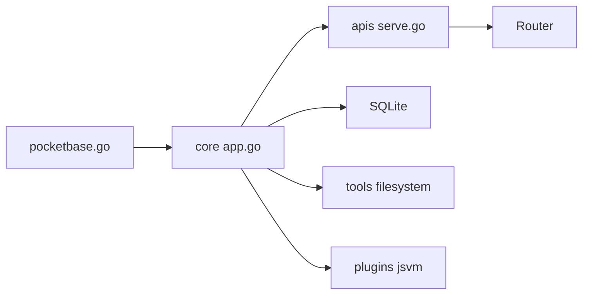

# pocketbase/pocketbase

> Go backend in a single binary: SQLite database, API, authentication, files and admin interface.

## The problem
Setting up a small backend (database, accounts, storage, realtime) for a prototype requires assembling multiple services.

## What it actually does
PocketBase embeds SQLite, a REST API, realtime subscriptions, user management (password, OTP, OAuth2, MFA), local or S3-compatible files, backups, SMTP emails and a dashboard. It runs standalone or as a Go library; you extend it in JavaScript (built-in VM) or in Go.

## How it is wired


## Trying it
```bash
./pocketbase serve
cd examples/base
CGO_ENABLED=0 go build
./base serve
```

## Cost and gotchas
Free. The README warns: under active development, backward compatibility not guaranteed before v1.0.0. Building requires Go 1.27+.

## What it is not
Not an analytical database engine: embedded SQLite, with no external broker for realtime.

## Alternatives
No alternative named in the README.

## For you
Worth watching: handy as a light backend for an AI application, but pre-v1 and outside your core area.
