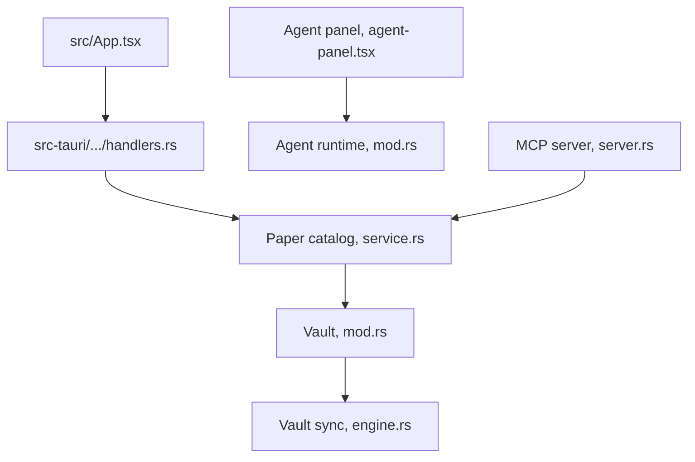

# poco-ai/Agentero

> Local research workstation that links PDFs, Markdown notes and AI agents through ACP and MCP.

## The problem
Papers in Zotero, notes in Obsidian and conversations with models in web windows: context is scattered and copied by hand.

## What it actually does
Tauri application: PDF reader with annotations, extraction of formulas and tables into Markdown and LaTeX, notes with `[[ ]]` links, translation, a paper radar (Cool Papers, RSS, arXiv). Local agents connect through ACP, and an MCP server exposes the library. Zotero import, headless CLI, S3 or WebDAV sync. Standard PDF and Markdown files.

## How it is wired


## Trying it
```bash
brew tap poco-ai/agentero
brew install --cask agentero
brew install agentero
agentero --help
```

## Cost and gotchas
Free, MIT. Linux: Ubuntu 22.04+ with `webkit2gtk 4.1`. Translation and agents may require your own keys or tools (Claude Code, Codex). Documentation mostly in Chinese.

## What it is not
Not a declared replacement for Zotero, but a complement. Not an agent: it hosts others.

## Alternatives
Zotero, cited in the README as a reference that the tool complements rather than replaces.

## For you
Watch: MCP access to a paper library and its notes speaks to an AI profile, but the project dates from July 2026 and remains to be proven.
