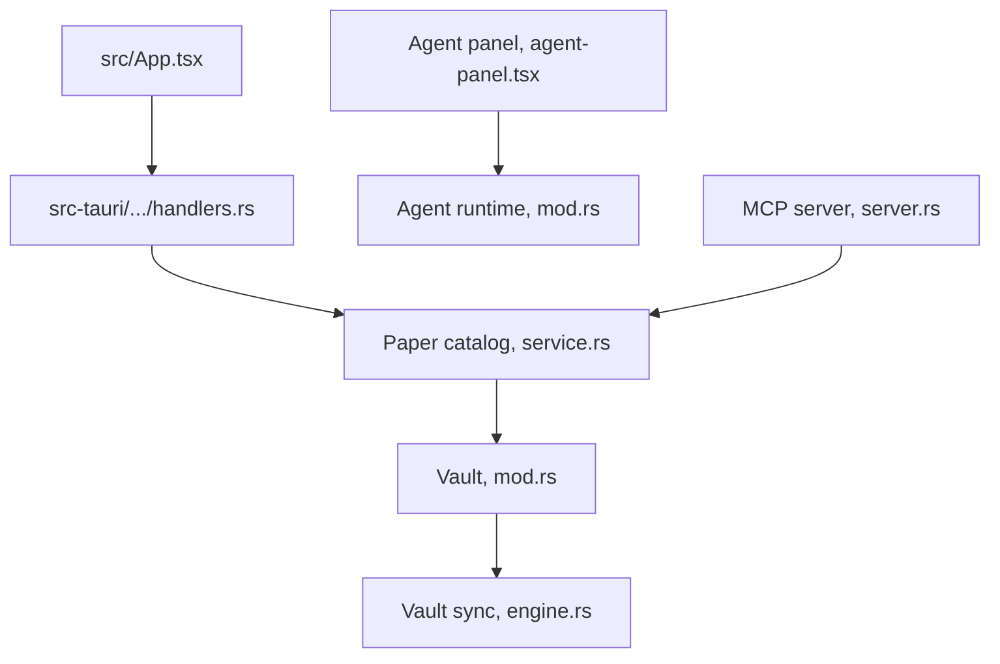

# poco-ai/Agentero

> Poste de travail de recherche local qui relie PDF, notes Markdown et agents IA via ACP et MCP.

## Le problème
Articles dans Zotero, notes dans Obsidian et échanges avec les modèles dans des fenêtres web : le contexte est dispersé et recopié à la main.

## Ce que ça fait vraiment
Application Tauri : lecteur PDF avec annotations, extraction de formules et tableaux en Markdown et LaTeX, notes avec liens `[[ ]]`, traduction, radar d'articles (Cool Papers, RSS, arXiv). Les agents locaux se connectent par ACP, et un serveur MCP expose la bibliothèque. Import Zotero, CLI sans interface, synchronisation S3 ou WebDAV. Fichiers PDF et Markdown standards.

## Comment c'est branché


## Essayer
```bash
brew tap poco-ai/agentero
brew install --cask agentero
brew install agentero
agentero --help
```

## Coût et pièges
Gratuit, MIT. Linux : Ubuntu 22.04+ avec `webkit2gtk 4.1`. Traduction et agents peuvent demander tes propres clés ou outils (Claude Code, Codex). Documentation principalement en chinois.

## Ce que ce n'est pas
Ce n'est pas un remplaçant déclaré de Zotero, mais un complément. Ce n'est pas un agent : il en héberge d'autres.

## Alternatives
Zotero, cité dans le README comme référence que l'outil complète plutôt qu'il ne remplace.

## Pour toi
À surveiller : l'accès MCP à une bibliothèque d'articles et ses notes parle à un profil IA, mais le projet date de juillet 2026 et reste à éprouver.

