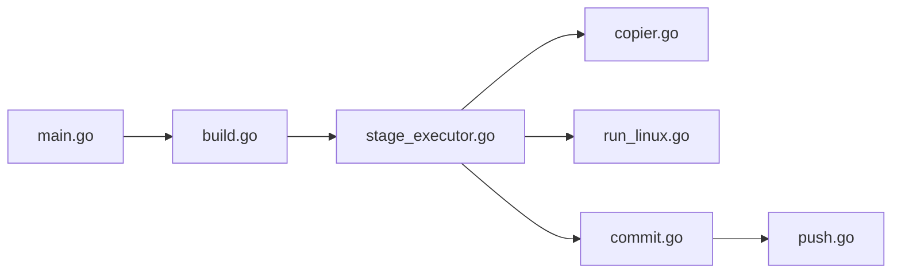

# podman-container-tools/buildah

> Command-line tool for building OCI images without a daemon, with or without a Dockerfile.

## The problem
Build container images without a Docker daemon or root privileges, and be able to script the build.

## What it actually does
Creates a working container from an image or `scratch`, mounts its filesystem, adds content, configures it, then commits it as an image (`commit`). `buildah build` reads a Containerfile or Dockerfile. Fork-exec, no daemon, with a reusable Go API (Podman uses it).

## How it is wired


## Trying it
```bash
ctr1=$(buildah from "${1:-fedora}")
buildah config --port 80 "$ctr1"
buildah commit "$ctr1" "${2:-$USER/lighttpd}"
```

## Cost and gotchas
Free. Buildah containers are not visible from Podman and vice versa (different storage).

## What it is not
Not a container runtime engine: to manage containers, the README points to Podman.

## Alternatives
- Podman: complementary, it manages and runs containers.

## For you
Keep an eye on it: handy for building ML images in CI without a daemon, if you are not already satisfied with `docker build`.
