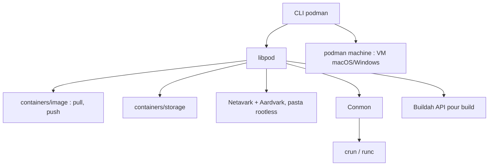

# podman-container-tools/podman

> Daemonless OCI container and pod manager with a Docker-compatible CLI.

## The problem
A container daemon running as root is a permanent attack surface and consumes resources while idle.
Running containers as a normal user usually requires a setuid binary.

## What it actually does
Manages images, containers, volumes and pods (groups of containers sharing resources); OCI and Docker images, pull with trust verification, push to registries.
Full lifecycle: creation from an image or an exploded rootfs, execution, checkpoint/restore via CRIU, removal; networking via Netavark and Aardvark, rootless via pasta.
No daemon: less attack surface and no idle consumption; REST API offering a Docker-compatible interface and an extended Podman interface.
Rootless through user namespaces: a container never has more privileges than the user who launched it. On macOS and Windows, everything goes through a `podman machine` VM.

## How it is wired


## Trying it
```
$ podman run quay.io/podman/hello
```

## Cost and gotchas
Free. Prior administrator configuration is required before rootless use, documented in the installation guide.
Only the most recent version receives upstream support; exception for the v5.8 series, maintained until June 2027 for CVEs and critical fixes only.

## What it is not
It is not a full image-building tool: Buildah handles that, Podman uses its Go API.
It is not a CRI runtime for Kubernetes: that is the role of CRI-O.
It is not the tool for signing and pushing to various storage backends: that is Skopeo.

## Alternatives
- Buildah — building OCI images without a Dockerfile or root privileges; complementary rather than competing.
- CRI-O — the daemon specialized for Kubernetes' CRI interface.
- Skopeo — signing and transferring images between storage backends.

## For you
Direct replacement for Docker on your workstation and your CI runners: same CLI, no root daemon.
