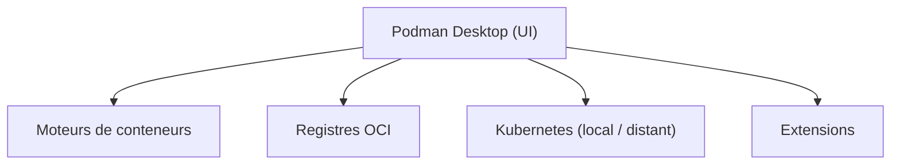

# podman-desktop/podman-desktop

> Graphical interface for working with containers and Kubernetes through Podman, locally or remotely.

## The problem
Managing containers, pods, images and Kubernetes clusters on the command line is cumbersome to set up, especially on a developer workstation.

## What it actually does
Installs, configures and updates Podman, provides a tray icon and a dashboard (containers, images, pods, volumes). Manages OCI registries and proxies, converts pods for Kubernetes and deploys to local or remote clusters. Extended through extensions.

## How it is wired

Simplified diagram: the README does not provide one.

## Trying it
```bash
pnpm install && pnpm watch
```
For user installation: download from podman-desktop.io/downloads.

## Cost and gotchas
Free. 918 open issues. The README mentions an optional early-adopter program, with no effect on features.

## What it is not
Not a container engine: it drives Podman and other engines. Not a managed Kubernetes platform.

## Alternatives
No alternative named in the README.

## For you
Worth watching: handy for testing training or inference images and Kubernetes deployments locally without Docker Desktop; with no containers, no interest.
