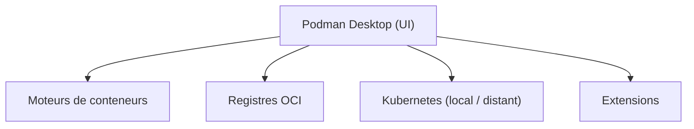

# podman-desktop/podman-desktop

> Interface graphique pour travailler avec conteneurs et Kubernetes via Podman, en local ou à distance.

## Le problème
Gérer des conteneurs, pods, images et clusters Kubernetes en ligne de commande est lourd à configurer, surtout sur poste de développeur.

## Ce que ça fait vraiment
Installe, configure et met à jour Podman, fournit une icône système et un tableau de bord (conteneurs, images, pods, volumes). Gère les registres OCI et les proxys, convertit des pods pour Kubernetes et déploie vers des clusters locaux ou distants. Étendu par des extensions.

## Comment c'est branché

Schéma simplifié : le README ne fournit pas de diagramme.

## Essayer
```bash
pnpm install && pnpm watch
```
Pour l'installation utilisateur : téléchargement depuis podman-desktop.io/downloads.

## Coût et pièges
Gratuit. 918 issues ouvertes. Le README mentionne un programme optionnel d'adoptants précoces, sans effet sur les fonctions.

## Ce que ce n'est pas
Pas un moteur de conteneurs : il pilote Podman et d'autres moteurs. Pas une plateforme Kubernetes managée.

## Alternatives
Aucune alternative nommée dans le README.

## Pour toi
À surveiller : pratique pour tester en local des images d'entraînement ou d'inférence et des déploiements Kubernetes sans Docker Desktop ; sans conteneurs, aucun intérêt.

