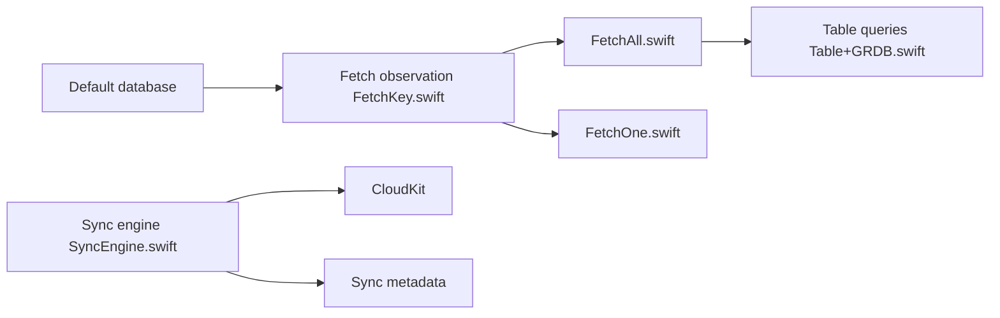

# pointfreeco/sqlite-data

> Swift library on SQLite/GRDB, an alternative to SwiftData, with CloudKit synchronization.

## The problem
SwiftData is slow and limited for advanced queries, and its model hides SQL and the schema.

## What it actually does
`@Table`, `@FetchAll`, `@FetchOne` query SQLite via StructuredQueries and GRDB, observed by SwiftUI, UIKit or `@Observable`. An optional `SyncEngine` synchronizes the database with CloudKit, sharing included. The README publishes benchmarks close to raw SQLite.

## How it is wired


## Trying it
```bash
# Package.swift
.package(url: "https://github.com/pointfreeco/sqlite-data", from: "1.0.0")
.product(name: "SQLiteData", package: "sqlite-data")
```

## Cost and gotchas
Free. Requires knowing SQLite (schema, joins, indexes). Synchronization assumes the Apple ecosystem and an iCloud account on the user's side.

## What it is not
Not a cross-platform server-side database: it is an Apple app tool. It is not an ORM that hides SQL.

## Alternatives
GRDB, SQLite.swift and Lighter, cited in the benchmarks.

## For you
Ignore: a persistence tool for Swift/Apple developers, outside the data/AI/MLOps scope.
