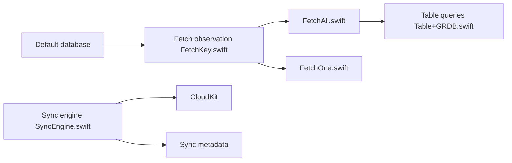

# pointfreeco/sqlite-data

> Bibliothèque Swift sur SQLite/GRDB, alternative à SwiftData, avec synchronisation CloudKit.

## Le problème
SwiftData est lent et limité sur des requêtes avancées, et son modèle cache SQL et schéma.

## Ce que ça fait vraiment
`@Table`, `@FetchAll`, `@FetchOne` interrogent SQLite via StructuredQueries et GRDB, observés par SwiftUI, UIKit ou `@Observable`. Un `SyncEngine` optionnel synchronise la base avec CloudKit, partage compris. Le README publie des benchmarks proches du SQLite brut.

## Comment c'est branché


## Essayer
```bash
# Package.swift
.package(url: "https://github.com/pointfreeco/sqlite-data", from: "1.0.0")
.product(name: "SQLiteData", package: "sqlite-data")
```

## Coût et pièges
Gratuit. Demande de connaître SQLite (schéma, jointures, index). La synchronisation suppose l'écosystème Apple et un compte iCloud côté utilisateur.

## Ce que ce n'est pas
Pas une base multiplateforme côté serveur : c'est un outil d'appli Apple. Ce n'est pas un ORM qui masque le SQL.

## Alternatives
GRDB, SQLite.swift et Lighter, cités dans les benchmarks.

## Pour toi
Ignorer : un outil de persistance pour développeurs Swift/Apple, hors du périmètre data/IA/MLOps.

