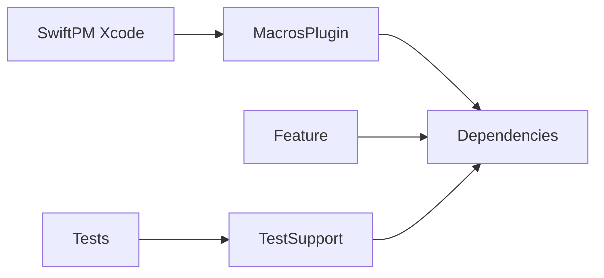

# pointfreeco/swift-dependencies

> Swift dependency management library inspired by the SwiftUI environment, to make code testable.

## The problem
Uncontrolled `Date()`, `UUID()`, clocks and network clients make tests slow and non-deterministic and previews fragile.

## What it actually does
Declares dependencies via `@Dependency(\.clock)`, `\.date.now`, `\.uuid`, etc., propagates them throughout the application and overrides them per test or preview with the `.dependencies` trait. Provides immediate clocks and incrementing UUIDs. Macros generate the registration code.

## How it is wired


## Trying it
```swift
.package(url: "https://github.com/pointfreeco/swift-dependencies", from: "1.0.0")
```
Then add `.product(name: "Dependencies", package: "swift-dependencies")` to the target.

## Cost and gotchas
Free. Better suited to single-entry-point systems.

## What it is not
Not a general dependency injection for other languages. Not a testing framework in itself.

## Alternatives
The README cites Factory, Needle, Swinject and Weaver.

## For you
Ignore unless you write Swift apps: the principle of controllable dependencies is good, but the tool is Swift-specific.
