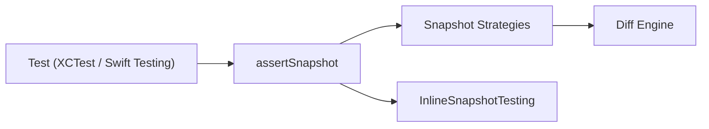

# pointfreeco/swift-snapshot-testing

> Swift snapshot testing library for views, URL requests and Codable values.

## The problem
Checking that an interface or a data structure has not changed without hand-writing assertions on every detail.

## What it actually does
`assertSnapshot(of:as:)` records a snapshot on disk on the first run (image, `recursiveDescription`, JSON, plist, dump), then compares it to subsequent runs. Strategies are extensible. Two modules: `SnapshotTesting` and `InlineSnapshotTesting` (inline snapshots). Works on iOS, macOS, tvOS and Linux, with SceneKit, SpriteKit and WebKit.

## How it is wired


## Trying it
```bash
assertSnapshot(of: vc, as: .image)
```
Installation via Swift Package Manager: add the package `https://github.com/pointfreeco/swift-snapshot-testing` (from: "1.12.0") to a test target.

## Cost and gotchas
Free. Snapshots must be compared using the same simulator as the reference one, otherwise images diverge. Add the package to a test target, not to the app.

## What it is not
Not a tool for testing ML models or data: it is UI and Swift value testing. 220 open issues.

## Alternatives
- iOSSnapshotTestCase: the ancestor that inspired the library.
- Jest: the JavaScript reference for snapshot testing.

## For you
Ignore: Swift/iOS testing tool, of no interest to a data, AI or MLOps profile outside Apple app development.
