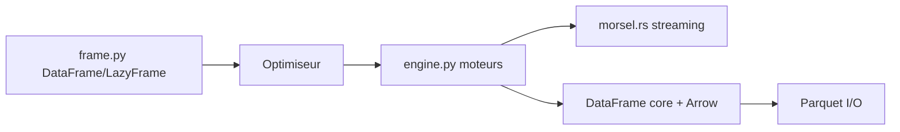

# pola-rs/polars

> Analytical query engine for DataFrames, written in Rust, with a Python API, lazy execution and streaming.

## The problem
pandas runs out of memory and time on large tables.

## What it actually does
Composes expressions into a lazy query, automatically optimized and run in parallel; a streaming engine for data larger than RAM. Arrow in-memory format, SQL, optional NVIDIA GPU, extensions (I/O and expressions), a distributed version is hinted at. Bindings for Python, Rust, Node.js, R.

## How it is wired


## Trying it
```sh
pip install polars
```
```python
import polars as pl
pl.scan_parquet("orders.parquet").filter(pl.col("status") == "shipped").collect()
```
Streaming: `collect(engine='streaming')`.

## Cost and gotchas
Free. Building from source requires Rust and maturin. Older CPUs or more than 2^32 rows: special installs (see the guide). Polars Cloud exists as a separate offering.

## What it is not
Not a copy-paste of the pandas API: the expression syntax is different. Not a distributed system in itself.

## Alternatives
No alternative named in the README.

## For you
Adopt: replaces pandas on large volumes with a consistent API and a streaming engine, directly useful in data science.
