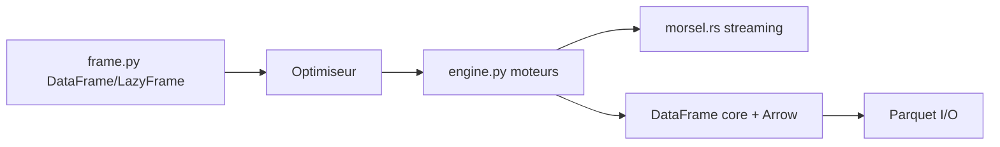

# pola-rs/polars

> Moteur de requêtes analytiques pour DataFrames, en Rust, avec API Python, exécution paresseuse et streaming.

## Le problème
pandas sature en mémoire et en temps sur des tables volumineuses.

## Ce que ça fait vraiment
Compose des expressions en requête paresseuse, optimisée automatiquement, exécutée en parallèle ; moteur streaming pour les données plus grandes que la RAM. Format Arrow en mémoire, SQL, GPU NVIDIA optionnel, extensions (I/O et expressions), version distribuée évoquée. Liaisons Python, Rust, Node.js, R.

## Comment c'est branché


## Essayer
```sh
pip install polars
```
```python
import polars as pl
pl.scan_parquet("orders.parquet").filter(pl.col("status") == "shipped").collect()
```
Streaming : `collect(engine='streaming')`.

## Coût et pièges
Gratuit. Compiler depuis les sources demande Rust et maturin. Anciens CPU ou plus de 2^32 lignes : installations spéciales (voir guide). Polars Cloud existe en offre séparée.

## Ce que ce n'est pas
Pas un copier-coller de l'API pandas : syntaxe d'expressions différente. Pas un système distribué en soi.

## Alternatives
Aucune alternative nommée dans le README.

## Pour toi
Adopter : remplace pandas sur les gros volumes avec une API cohérente et un moteur streaming, directement utile en data science.

