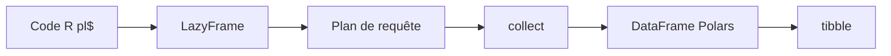

# pola-rs/r-polars

> R bindings for the Polars DataFrame library, for those processing large data in R.

## The problem
Classic R data frames do not optimize queries and struggle with datasets larger than RAM.

## What it actually does
Brings Polars (written in Rust) to R: lazy execution with an optimized query plan, use of all cores, strict schema. The API follows that of Python Polars through the `pl$` environment and the `$` operator. Conversion to tibble, and extensions polarssql (DBI/dbplyr) and tidypolars.

## How it is wired


## Trying it
```r
Sys.setenv(NOT_CRAN = "true")
install.packages("polars", repos = "https://community.r-multiverse.org")
library(polars)
q <- pl$scan_csv(csv_file, infer_schema_files = 10)$filter(pl$col("Sepal.Length") > 5)
df <- q$collect()
```

## Cost and gotchas
Free. Installation via R-multiverse or R-universe rather than CRAN by default; `NOT_CRAN=true` required. License present but not identified: to verify.

## What it is not
It is not Python Polars: the syntax is close but not identical. It is not a tidyverse replacement (tidypolars serves as a bridge).

## Alternatives
tidypolars (tidyverse syntax on polars); polarssql (DBI/dbplyr backend).

## For you
Worth watching: useful if you do R on large volumes; in Python, use Polars directly.
