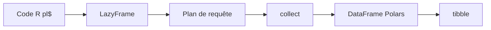

# pola-rs/r-polars

> Liaisons R de la bibliothèque DataFrame Polars, pour qui traite des données volumineuses en R.

## Le problème
Les data frames R classiques n'optimisent pas les requêtes et peinent sur des jeux de données plus gros que la RAM.

## Ce que ça fait vraiment
Fournit Polars (écrit en Rust) à R : exécution paresseuse avec plan de requête optimisé, usage de tous les cœurs, schéma strict. L'API suit celle de Python Polars via l'environnement `pl$` et l'opérateur `$`. Conversion vers tibble, et extensions polarssql (DBI/dbplyr) et tidypolars.

## Comment c'est branché


## Essayer
```r
Sys.setenv(NOT_CRAN = "true")
install.packages("polars", repos = "https://community.r-multiverse.org")
library(polars)
q <- pl$scan_csv(csv_file, infer_schema_files = 10)$filter(pl$col("Sepal.Length") > 5)
df <- q$collect()
```

## Coût et pièges
Gratuit. Installation via R-multiverse ou R-universe plutôt que CRAN par défaut ; `NOT_CRAN=true` requis. Licence présente mais non identifiée : à vérifier.

## Ce que ce n'est pas
Ce n'est pas Polars Python : la syntaxe est proche mais pas identique. Ce n'est pas un remplaçant de tidyverse (tidypolars sert de pont).

## Alternatives
tidypolars (syntaxe tidyverse sur polars) ; polarssql (backend DBI/dbplyr).

## Pour toi
Surveiller : utile si tu fais du R sur gros volumes ; en Python, utilise Polars directement.

