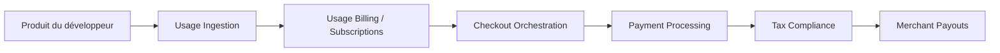

# polarsource/polar

> Billing platform and official merchant of record for AI startups that bill for tokens, agents and compute.

## The problem
Usage-based billing (tokens, calls, GPU seconds) means building measurement, payment, VAT and a customer portal yourself.

## What it actually does
Polar measures usage events, handles subscriptions, seats, credits, trials and discounts, orchestrates payment, computes taxes as the official merchant, then pays out revenue. It offers a checkout, a customer portal, a dashboard (web and mobile) and a public API with webhooks. JavaScript and Python SDKs exist. The detail of the server code was not explored in the architecture provided.

## How it is wired

## Trying it
No command documented in the README: integration goes through the public API, the webhooks and the `polar-js` and `polar-python` SDKs. `DEVELOPMENT.md` describes the development environment.

## Cost and gotchas
Per-transaction commission: Starter 5.00% + $0.50, Pro 3.80% + $0.40, Growth 3.60% + $0.35, Scale 3.40% + $0.30, excluding additional fees. A startup program may offer one year of an advanced plan.

## What it is not
Not simply software to install: the value is the hosted service that carries tax compliance. The README does not document self-hosting.

## Alternatives
No alternative named in the README.

## For you
Keep an eye on it: interesting if you bill an AI product by usage, but you depend on a third-party service with a commission; compare before committing.
