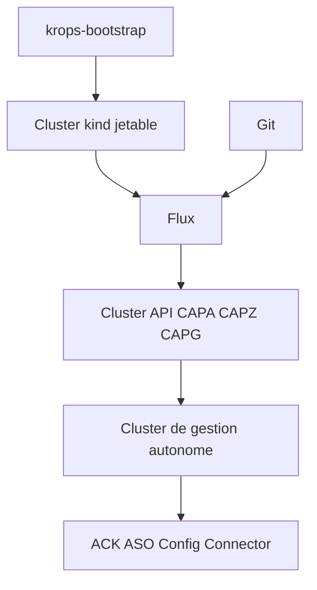

# polarsquad/krops

> GitOps model that manages cloud infrastructure through the Kubernetes API and YAML, for platform engineers.

## The problem
Terraform imposes HCL, a state file and separate plan/apply runs, on top of the tools for workloads.

## What it actually does
krops provides no controller: it combines Cluster API (clusters), each cloud's native operator (ACK on AWS) and Flux from Git. A disposable kind cluster bootstraps Flux, then the pivot hands control over to a self-managing management cluster. The Rust CLI `krops-bootstrap` drives bootstrap, pivot and teardown. It is a reference implementation, not a product.

## How it is wired
Simplified diagram based on the sheet, no diagram provided.



## Trying it
```sh
docker build -f bootstrap-rs/Dockerfile -t krops-toolbox:dev .
mkdir -p .kube
docker run --rm -it \
  -v "$PWD:/workspace" -w /workspace \
  -v /var/run/docker.sock:/var/run/docker.sock \
  -v "$PWD/.kube:/root/.kube" \
  -e KUBECONFIG=/workspace/.kube/kind.yaml \
  krops-toolbox:dev local-host
```

## Cost and gotchas
The `local-host` environment only needs Docker. The AWS, Azure and GCP environments require a GitHub token, an age key and cloud credentials, with billed resources.

## What it is not
Not a self-service portal for developers nor a turnkey replacement for Crossplane. Crossplane integration is decided but not implemented.

## Alternatives
Crossplane: the closest comparison, which provides its own providers. Terraform and OpenTofu: the HCL-with-state-file model that krops aims to replace.

## For you
Worth watching: interesting for an MLOps engineer who already manages Kubernetes and wants infrastructure in GitOps, but young (created in April 2026) and demanding.
