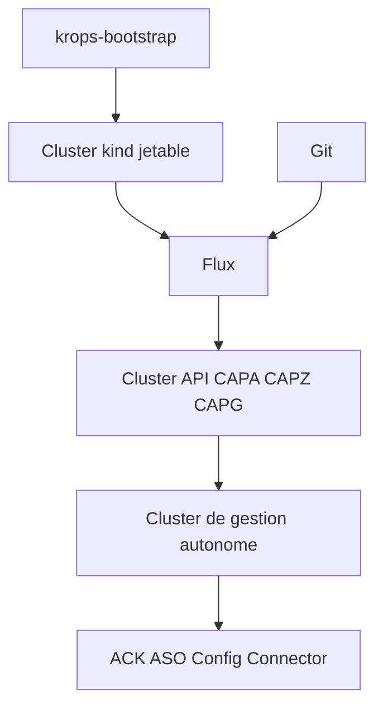

# polarsquad/krops

> Modèle GitOps qui gère l'infrastructure cloud par l'API Kubernetes et du YAML, pour ingénieurs de plateforme.

## Le problème
Terraform impose HCL, un fichier d'état et des exécutions plan/apply séparées, en plus des outils pour les charges de travail.

## Ce que ça fait vraiment
krops ne fournit aucun contrôleur : il combine Cluster API (clusters), l'opérateur natif de chaque cloud (ACK sur AWS) et Flux depuis Git. Un cluster kind jetable amorce Flux, puis le pivot donne la main à un cluster de gestion autonome. Le CLI Rust `krops-bootstrap` pilote amorçage, pivot et démontage. C'est une implémentation de référence, pas un produit.

## Comment c'est branché
Schéma simplifié d'après la fiche, sans diagramme fourni.



## Essayer
```sh
docker build -f bootstrap-rs/Dockerfile -t krops-toolbox:dev .
mkdir -p .kube
docker run --rm -it \
  -v "$PWD:/workspace" -w /workspace \
  -v /var/run/docker.sock:/var/run/docker.sock \
  -v "$PWD/.kube:/root/.kube" \
  -e KUBECONFIG=/workspace/.kube/kind.yaml \
  krops-toolbox:dev local-host
```

## Coût et pièges
L'environnement `local-host` n'a besoin que de Docker. Les environnements AWS, Azure, GCP demandent un jeton GitHub, une clé age et des identifiants cloud, avec les ressources facturées.

## Ce que ce n'est pas
Pas un portail en libre-service pour développeurs ni un remplaçant clé en main de Crossplane. L'intégration de Crossplane est décidée mais pas implémentée.

## Alternatives
Crossplane : comparaison la plus proche, qui fournit ses propres fournisseurs. Terraform et OpenTofu : le modèle HCL avec fichier d'état que krops veut remplacer.

## Pour toi
À surveiller : intéressant pour un MLOps qui gère déjà Kubernetes et veut l'infrastructure en GitOps, mais jeune (créé en avril 2026) et exigeant.

