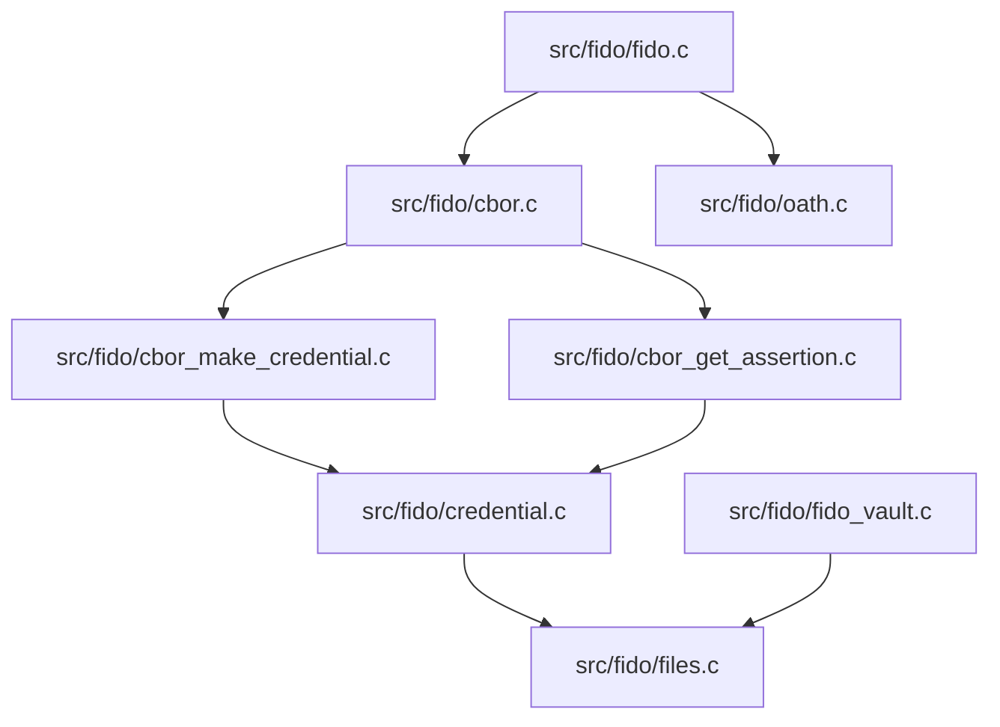

# polhenarejos/pico-fido

> Firmware that turns a Raspberry Pi Pico or an ESP32 into a FIDO2 / passkey USB key.

## The problem
Commercial hardware security keys are expensive and closed; you want an open FIDO key on cheap hardware.

## What it actually does
Receives CTAP commands in fido.c, decodes them with cbor.c and dispatches them to the handlers for credential creation, assertion and PIN code. Credentials are stored via files.c. Adds a vault, OATH (TOTP/HOTP), Yubikey OTP and an emulated keyboard. Python tests (pytest).

## How it is wired


## Trying it
```bash
git clone https://github.com/polhenarejos/pico-fido
git submodule update --init --recursive
cd pico-fido
mkdir build
cd build
PICO_SDK_PATH=/path/to/pico-sdk cmake .. -DPICO_BOARD=board_type -DUSB_VID=0x1234 -DUSB_PID=0x5678
make
```
Test: `pytest`.

## Cost and gotchas
The software is free, but you need the hardware (Pico, ESP32-S3) and the Pico SDK toolchain. The RP2040 does not protect the keys if stolen (no OTP); only the RP2350 and ESP32-S3 offer Secure Boot. Do not distribute a binary with a VID/PID you do not own.

## What it is not
Not a password manager nor a FIDO-certified key: it is a free implementation on a microcontroller.

## Alternatives
Yubikey and Nitrokey are cited for compatibility (Yubico applications, nitropy), SoloKeys for the origin of the tests.

## For you
Worth watching: relevant if you want an open FIDO key to secure your cloud access, to be adopted only with an RP2350 or ESP32-S3.
