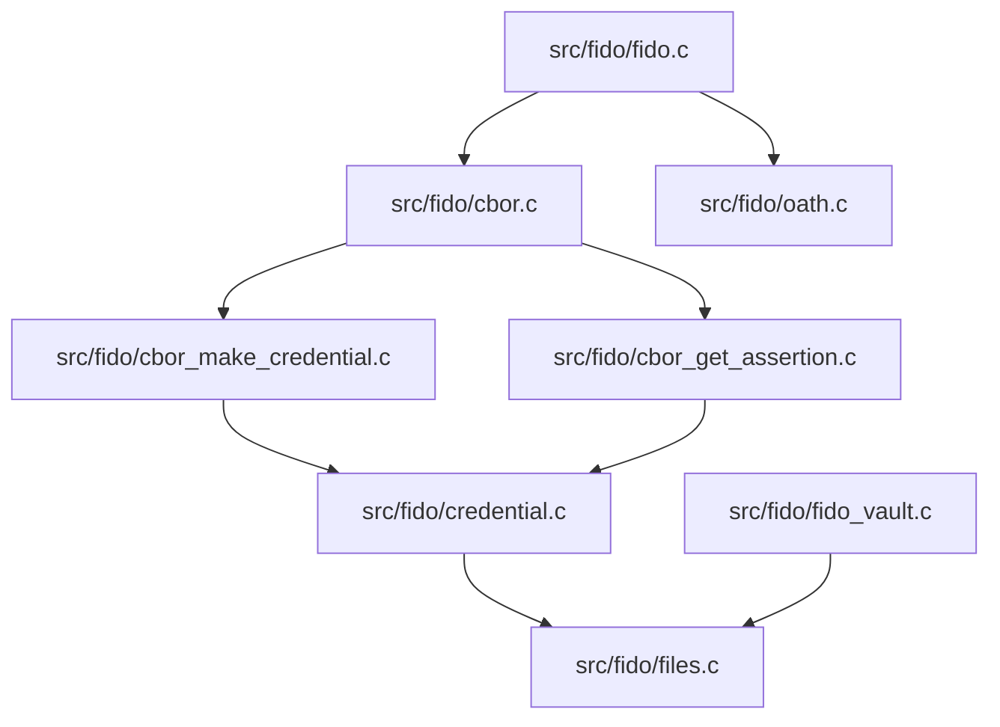

# polhenarejos/pico-fido

> Firmware qui transforme un Raspberry Pi Pico ou un ESP32 en clé FIDO2 / passkey USB.

## Le problème
Les clés de sécurité matérielles du commerce sont chères et fermées ; on veut une clé FIDO ouverte sur du matériel bon marché.

## Ce que ça fait vraiment
Reçoit les commandes CTAP dans fido.c, les décode avec cbor.c et les distribue aux gestionnaires de création de credential, d'assertion et de code PIN. Les credentials sont stockés via files.c. Ajoute un coffre (vault), OATH (TOTP/HOTP), OTP Yubikey et un clavier émulé. Tests Python (pytest).

## Comment c'est branché


## Essayer
```bash
git clone https://github.com/polhenarejos/pico-fido
git submodule update --init --recursive
cd pico-fido
mkdir build
cd build
PICO_SDK_PATH=/path/to/pico-sdk cmake .. -DPICO_BOARD=board_type -DUSB_VID=0x1234 -DUSB_PID=0x5678
make
```
Test : `pytest`.

## Coût et pièges
Logiciel gratuit, mais il faut le matériel (Pico, ESP32-S3) et la chaîne d'outils du Pico SDK. Le RP2040 ne protège pas les clés en cas de vol (pas d'OTP) ; seuls RP2350 et ESP32-S3 offrent Secure Boot. Ne pas distribuer un binaire avec un VID/PID dont on n'est pas titulaire.

## Ce que ce n'est pas
Ce n'est pas un gestionnaire de mots de passe ni une clé certifiée FIDO : c'est une implémentation libre sur microcontrôleur.

## Alternatives
Yubikey et Nitrokey sont cités pour la compatibilité (applications Yubico, nitropy), SoloKeys pour l'origine des tests.

## Pour toi
À surveiller : pertinent si tu veux une clé FIDO ouverte pour sécuriser tes accès cloud, à n'adopter qu'avec un RP2350 ou ESP32-S3.

