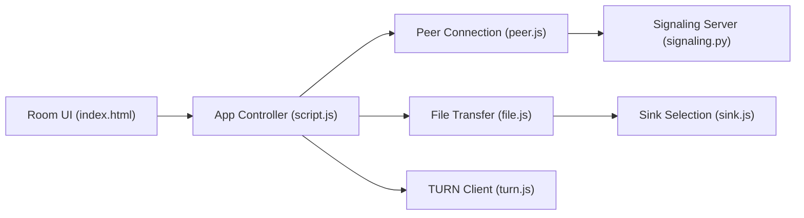

# polius/FileSync

> A self-hosted web application for sending files peer to peer between browsers.

## The problem
Sending a large file to several devices with no account, no cloud and no size limit.

## What it actually does
Files go directly from one browser to another over encrypted WebRTC; a WebSocket server is used only for matchmaking (SDP, ICE). Streaming writes (File System Access API, service worker, otherwise in-memory blob), automatic resume, a room shared by link or QR code with a password. Built-in TURN for cases with no direct connection.

## How it is wired


## Trying it
```bash
docker compose up -d
docker compose -f docker-compose-ssl.yml up -d
```

## Cost and gotchas
Docker and Compose; ports 80/443, 3478 (TCP+UDP) and UDP 50000-50100 for the TURN relay. HTTPS recommended, otherwise it falls back to the in-memory blob.

## What it is not
Not a storage or continuous-sync tool despite its name: it is an on-the-fly transfer between connected devices.

## Alternatives
- fsend: command-line equivalent cited by the author.

## For you
Ignore for your line of work: a good one-off transfer tool, but unrelated to data or AI.
