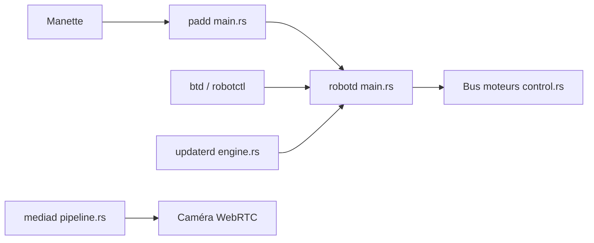

# pollen-robotics/microduck

> Embedded software for a small 25 cm biped robot, walking with learned policies, for those who own or build the robot.

## The problem
A robot with fifteen servomotors needs a real-time control loop, radios, a camera and updates that don't leave the machine unusable.

## What it actually does
Rust daemons on a Rockchip RK3566: `robotd` runs the 50 Hz loop and loads ONNX policies; `updaterd` installs signed releases and rolls them back if the robot boots badly; `configd`, `btd`, `padd`, `mediad` (WebRTC) and `tofd` handle network, Bluetooth, gamepad, camera and depth sensor. They all speak JSON-RPC over Unix sockets. The policies are trained in another repo, `microduck_rl`.

## How it is wired


## Trying it
```bash
scripts/duck-sim
```
The README mentions this MuJoCo simulator; the other commands (`robotctl`, `duckctl`) point to docs pages that are not reproduced.

## Cost and gotchas
You need the robot (sold elsewhere, link in the README) or the simulator. No API key mentioned.

## What it is not
Not the policy training (`microduck_rl` repo). Not usable without the hardware or the simulator. Not a generic robotics framework.

## Alternatives
None cited in the README, apart from `microduck_rl` which is complementary.

## For you
Ignore for everyday MLOps, but worth reading if you do sim2real: the ONNX export and the signed updates with rollback are well documented.
