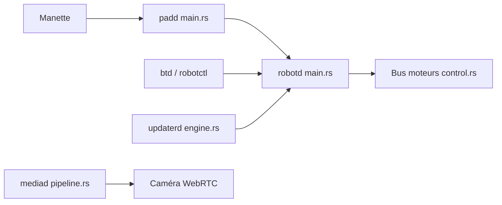

# pollen-robotics/microduck

> Logiciel embarqué d'un petit robot bipède de 25 cm, marchant par politiques apprises, pour qui possède ou construit le robot.

## Le problème
Un robot à quinze servomoteurs exige une boucle de contrôle temps réel, des radios, une caméra et des mises à jour qui ne rendent pas la machine inutilisable.

## Ce que ça fait vraiment
Des démons Rust sur un Rockchip RK3566 : `robotd` tient la boucle à 50 Hz et charge les politiques ONNX ; `updaterd` installe des versions signées et les annule si le robot démarre mal ; `configd`, `btd`, `padd`, `mediad` (WebRTC) et `tofd` gèrent réseau, Bluetooth, manette, caméra et capteur de profondeur. Tous parlent en JSON-RPC sur sockets Unix. Les politiques sont entraînées dans un autre dépôt, `microduck_rl`.

## Comment c'est branché


## Essayer
```bash
scripts/duck-sim
```
Le README mentionne ce simulateur MuJoCo ; les autres commandes (`robotctl`, `duckctl`) renvoient à des pages de docs non reproduites.

## Coût et pièges
Il faut le robot (vendu ailleurs, lien dans le README) ou le simulateur. Aucune clé d'API mentionnée.

## Ce que ce n'est pas
Pas l'entraînement des politiques (dépôt `microduck_rl`). Pas utilisable sans le matériel ou le simulateur. Pas un framework générique de robotique.

## Alternatives
Aucune citée dans le README, hors `microduck_rl` qui est complémentaire.

## Pour toi
À ignorer pour le MLOps courant, mais à lire si tu fais du sim2real : l'export ONNX et les mises à jour signées avec retour arrière sont bien documentés.

