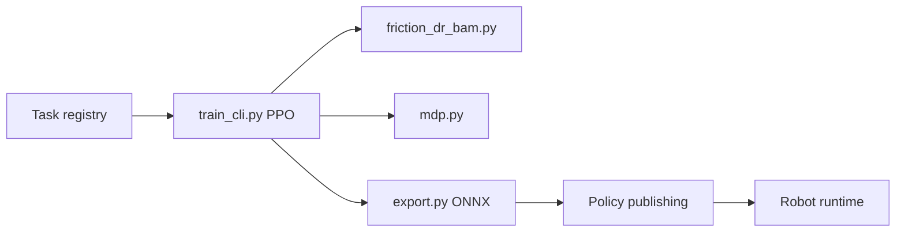

# pollen-robotics/microduck_rl

> Reinforcement learning environments for the Microduck biped robot, trained with mjlab and PPO.

## The problem
Transferring a walking policy of a small (800 g) robot from simulation to reality often fails because of the actuator/mechanical backlash gap.

## What it actually does
mjlab tasks (walking, getting up, sit/stand, rolling, kicking, roller skating) trained with PPO at 50 Hz. BAM actuator model with domain randomization and gear backlash simulation, a shared 61-dimension observation so that policies can be swapped. ONNX export with built-in normalization, publication on Hugging Face Hub, training possible via HF Jobs. CPU regression tests.

## How it is wired


## Trying it
```bash
git clone https://github.com/pollen-robotics/microduck_rl
cd microduck_rl
uv run train Mjlab-Velocity-Flat-MicroDuck --env.scene.num-envs 4096
uv run scripts/export.py Mjlab-Velocity-Flat-MicroDuck --wandb-run-path <...>
uv run scripts/infer_policy.py --walking output.onnx
```

## Cost and gotchas
CUDA GPU required (or HF Jobs). About 1-2 h for a usable walk at 4096 envs; `uv sync` downloads ~2 GB.

## What it is not
Not a generic RL framework: specific to Microduck, mostly useful with the robot and the `pollen-robotics/microduck` runtime.

## Alternatives
No alternative named in the README (it builds on mjlab and BAM).

## For you
Worth watching: a good sim2real recipe reference (actuator, DR, ONNX) to read even without the robot; otherwise too specific.
