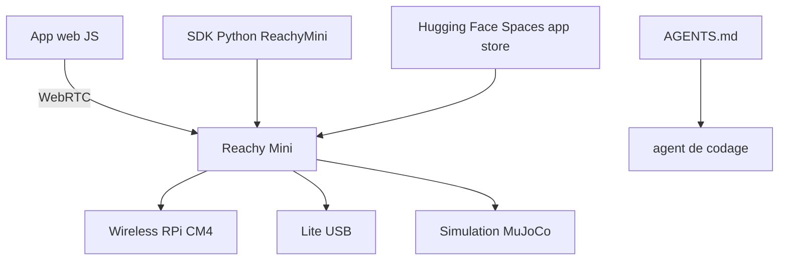

# pollen-robotics/reachy_mini

> Python and JavaScript SDK to control the small expressive robot Reachy Mini, with a simulation mode.

## The problem
Prototyping a robotics behavior usually requires a robot, a build environment and a deployment chain, all separate.
Sharing a demo assumes the other person installs the same stack.

## What it actually does
Three platforms: Wireless (Raspberry Pi CM4, battery, WiFi, onboard IMU), Lite (plugged into the computer by USB) and Simulation (MuJoCo, no hardware).
The Python SDK controls head pose and onboard control loops; `goto_target` with `create_head_pose` is enough for a first movement.
The recommended path for a new application is the JavaScript SDK: a static page that drives the robot over WebRTC from a browser, with no installation on the user's side.
An app store backed by Hugging Face Spaces lets you install conversation, radio or hand tracking in one click from the robot's dashboard.

## How it is wired


## Trying it
```python
from reachy_mini import ReachyMini
from reachy_mini.utils import create_head_pose

with ReachyMini() as mini:
    mini.goto_target(head=create_head_pose(z=10, roll=15, degrees=True, mm=True), duration=1.0)
```

## Cost and gotchas
The robot is bought as a kit and takes 2 to 3 hours to assemble; only the MuJoCo simulation is free.
The app store goes through Hugging Face, so an account and a dependency on their infrastructure. `uv` speeds up installs, with fallback to `pip`.

## What it is not
Not a turnkey autonomous robot: the Lite version stays plugged into the computer and mains-powered.
Not an industrial platform: the README explicitly targets tinkerers and AI builders.
The conversational app relies on LLMs, hence on an external service and cost not detailed here.

## Alternatives
No alternative named in the README.

## For you
Set aside unless you have a personal interest in robotics: nothing in your data chain plugs into it.
