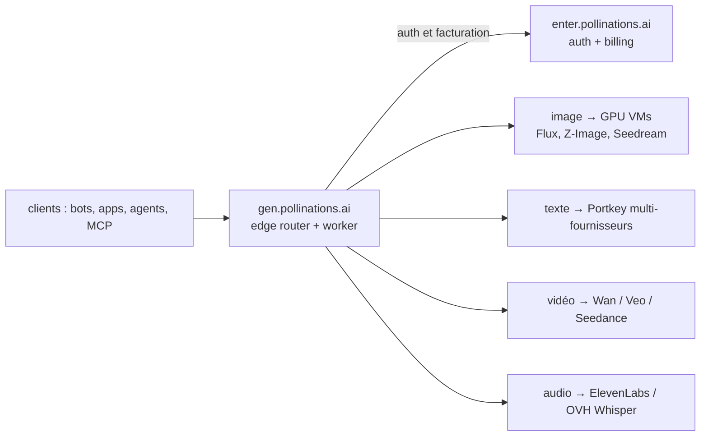

# pollinations/pollinations

> Open generative platform: text, image, audio, video, 3D and embeddings on a single endpoint.

## The problem
Putting together a multimodal demo means opening an account, billing and an SDK for each modality,
with three or four different providers.

## What it actually does
Exposes `gen.pollinations.ai` as a single endpoint for all generations, with billing in "Pollen"
credits ($1 ≈ 1 Pollen) and two key types: `pk_` for public clients, with budget and permissions set
at creation, and `sk_` for server use only. The API is OpenAI-compatible, so the official SDKs work
by changing the `baseURL`. Model identifiers now follow `publisher/model` (`flux` →
`black-forest-labs/flux.1-schnell`), the old ones remaining as aliases. You can register a "managed
agent" (system prompt + base model + tools) and call it like an ordinary model via
`owner/agent-name`. A hosted MCP server and a `polli` CLI round it out.

## How it is wired


## Trying it
```bash
curl -H "Authorization: Bearer YOUR_API_KEY" 'https://gen.pollinations.ai/image/a%20beautiful%20sunset' -o image.jpg
curl 'https://gen.pollinations.ai/text/Hello%20world?key=YOUR_API_KEY'
curl 'https://gen.pollinations.ai/v1/audio/transcriptions' -H "Authorization: Bearer YOUR_API_KEY" -F file=@audio.mp3 -F model=whisper-large-v3
curl 'https://gen.pollinations.ai/v1/embeddings' -H 'Content-Type: application/json' -H 'Authorization: Bearer YOUR_API_KEY' -d '{"model": "openai-3-small", "input": "Hello world!"}'
npx @pollinations/cli gen image "cyberpunk city at night" --model flux --output city.png
npm install -g @pollinations/cli
export POLLINATIONS_API_KEY=sk_...
```

## Cost and gotchas
Freemium: Pollen can be bought, but also earned through "Quests" without a credit card. `sk_` keys
must never go client-side; browser clients pass the key as a URL parameter for the real-time
WebSocket, which exposes it in logs. All billing depends on a single service.

## What it is not
Not a model nor a runtime: it is a router in front of Flux, GPT, Claude, Gemini, Seedream, ElevenLabs
and the like, with their limits and outages. Not realistically self-hostable: the repository
contains the Workers and the front end, but nothing indicates how to run without their infrastructure.

## Alternatives
- The OpenAI SDKs / Vercel AI SDK pointed directly at the providers: less dependency.

## For you
Useful for a multimodal demo put together in an hour; not for recurring processing.
