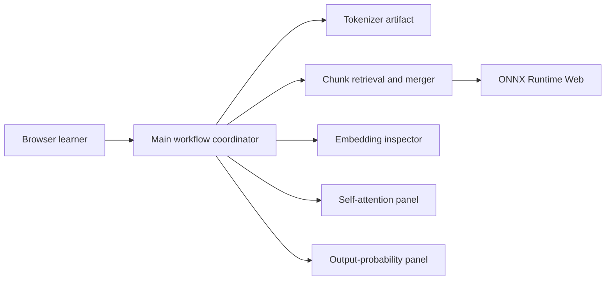

# poloclub/transformer-explainer

> Interactive visualization from Georgia Tech that runs GPT-2 in the browser to explain Transformers.

## The problem
Understanding attention, QKV and the output softmax from equations remains abstract for most learners.

## What it actually does
A SvelteKit application that loads the GPT-2 tokenizer and an ONNX model split into 63 chunks, run by ONNX Runtime Web. You type a text, adjust temperature and sampling, and see embeddings, QKV projections, attention, MLP and next-token probabilities. Cached results are used while loading; an interactive guide and an article come with it. CHI 2026 paper.

## How it is wired


## Trying it
```bash
git clone https://github.com/poloclub/transformer-explainer.git
cd transformer-explainer
npm install
npm run dev
```

## Cost and gotchas
Free, usable online with no installation; locally, Node 20 and NPM 10. The app pushes usage events to `window.dataLayer` (Google Tag Manager).

## What it is not
Not an interpretability tool for your own models: fixed on GPT-2 small. No inference backend.

## Alternatives
- Diffusion Explainer: same team, for Stable Diffusion.
- CNN Explainer and GAN Lab: other interactive explainers from the same lab.

## For you
Adopt as a teaching aid: it is the fastest way to show a team what a Transformer really does, with no installation and on a real model.
