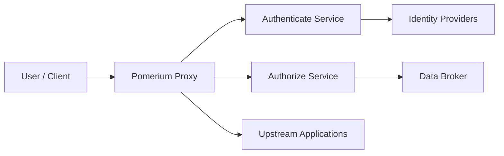

# pomerium/pomerium

> Identity-aware reverse proxy written in Go, replacing the VPN for access to internal apps.

## The problem
Giving access to internal apps without a VPN, by checking the identity and context of each request.

## What it actually does
A single binary (`cmd/pomerium`) bundles four services: proxy, authenticate (OIDC/SAML login), authorize (policy evaluation) and databroker (state and configuration over gRPC). The config is pushed to Envoy via xDS. A React interface is embedded. Pomerium Zero, a hosted control plane, is optional.

## How it is wired

## Trying it
No command documented in the provided README (it points to the external documentation).

## Cost and gotchas
An external identity provider is required. The hosted control plane Pomerium Zero is a separate offering.

## What it is not
It is not presented as an alternative VPN, but as a different approach. The README details neither installation nor configuration.

## Alternatives
- Pomerium Zero: the same product with a hosted control plane and management interface.

## For you
Watch: useful if you expose internal tools (MLflow, notebooks) without a VPN, but outside the core of data/AI.
