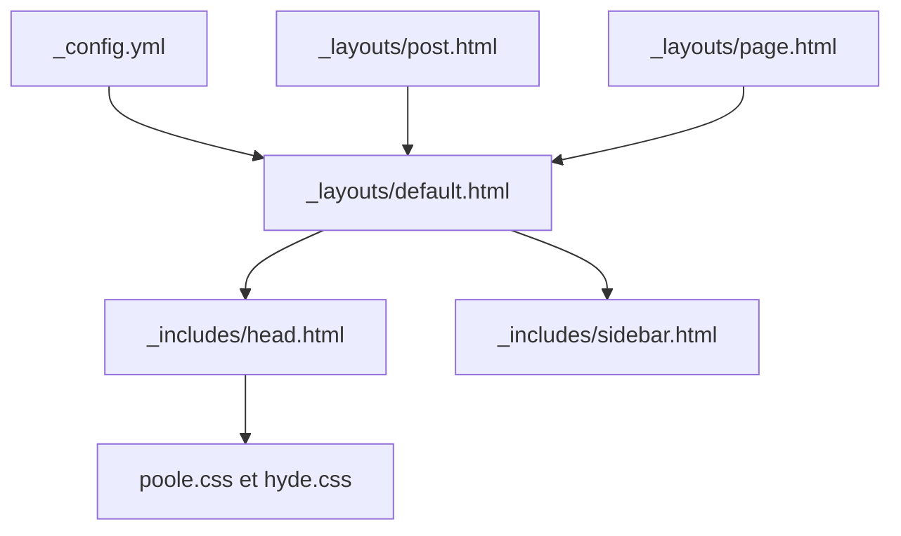

# poole/hyde

> Two-column Jekyll theme with a bold sidebar, based on Poole, for static blogs.

## The problem
A Jekyll blog without a theme requires designing the layout and styles yourself.

## What it actually does
A theme built on Poole: all templates go through `_layouts/default.html`, which includes `head.html` (poole and hyde stylesheets) and `sidebar.html`. Posts use `post.html`, static pages use `page.html`. Options: sidebar menu, fixed bar or not, eight base16 color themes and a reversed layout via a class.

## How it is wired


## Trying it
```bash
# Aucune commande dans ce README : il renvoie aux consignes d'usage de Poole pour installer Jekyll.
```

## Cost and gotchas
Free. A license is present but not identified by GitHub. Last push in July 2024, more than a year ago: a frozen theme. The `gh-pages` branch contains traffic analytics code to avoid.

## What it is not
Not a site generator: you need Jekyll alongside it. No dark mode or modern components documented.

## Alternatives
- Poole: the Jekyll base on which Hyde is built.

## For you
Ignore: an old static blog theme, unrelated to data, AI or MLOps work.
