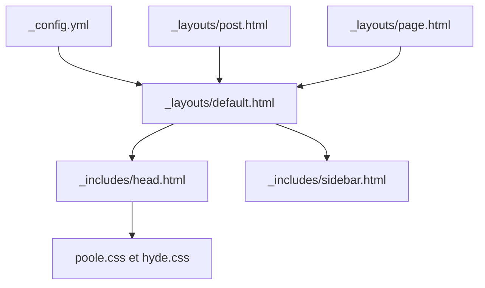

# poole/hyde

> Thème Jekyll à deux colonnes avec barre latérale marquée, basé sur Poole, pour blogs statiques.

## Le problème
Un blog Jekyll sans thème demande de dessiner la mise en page et les styles.

## Ce que ça fait vraiment
Un thème construit sur Poole : tous les gabarits passent par `_layouts/default.html`, qui inclut `head.html` (feuilles de style poole et hyde) et `sidebar.html`. Les articles utilisent `post.html`, les pages statiques `page.html`. Options : menu latéral, barre fixe ou non, huit thèmes de couleurs base16 et disposition inversée par une classe.

## Comment c'est branché


## Essayer
```bash
# Aucune commande dans ce README : il renvoie aux consignes d'usage de Poole pour installer Jekyll.
```

## Coût et pièges
Gratuit. Une licence est présente mais non identifiée par GitHub. Dernier push en juillet 2024, soit plus d'un an : thème figé. La branche `gh-pages` contient un code d'analyse de trafic à éviter.

## Ce que ce n'est pas
Pas un générateur de site : il faut Jekyll à côté. Pas de mode sombre ni de composants modernes documentés.

## Alternatives
- Poole : la base Jekyll sur laquelle Hyde est construit.

## Pour toi
À ignorer : thème de blog statique ancien, sans lien avec un travail data, IA ou MLOps.

