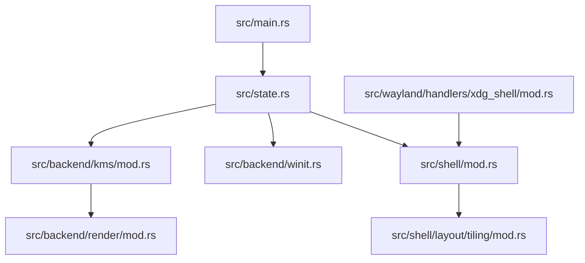

# pop-os/cosmic-comp

> Wayland compositor of the COSMIC desktop, for anyone building or packaging this Linux desktop session.

## The problem
A desktop environment needs a compositor that handles windows, workspaces and input. COSMIC has its own, written for it.

## What it actually does
main.rs builds the state, picks a KMS or winit backend for rendering, then the shell manages windows, tiling and workspaces from input and Wayland handlers. The README only describes development commands.

## How it is wired


## Trying it
```bash
just build-release
just install
just check
```

## Cost and gotchas
Free, but you need the Rust toolchain and the just tool (not listed among the allowed prerequisites). `just install-bare-session` also installs Wayland session files and systemd units: try it on a dedicated machine.

## What it is not
Not a standalone application: it is a piece of the COSMIC desktop. No usage documentation in the README, only development. GPL-3.0 license: copyleft.

## Alternatives
No alternative cited in the README.

## For you
Ignore: a desktop compositor has no link with data, AI or MLOps work, unless you are targeting COSMIC itself.
