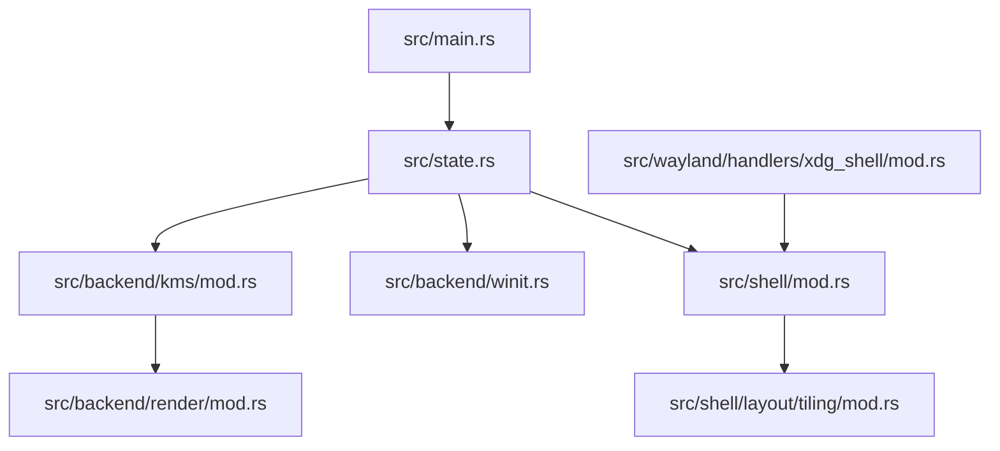

# pop-os/cosmic-comp

> Compositeur Wayland du bureau COSMIC, pour qui construit ou package cette session de bureau Linux.

## Le problème
Un environnement de bureau a besoin d'un compositeur qui gère fenêtres, espaces de travail et entrées. COSMIC a le sien, écrit pour lui.

## Ce que ça fait vraiment
main.rs construit l'état, choisit un backend KMS ou winit pour le rendu, puis le shell gère fenêtres, pavage et espaces de travail depuis les entrées et les handlers Wayland. Le README ne décrit que les commandes de développement.

## Comment c'est branché


## Essayer
```bash
just build-release
just install
just check
```

## Coût et pièges
Gratuit, mais il faut la chaîne Rust et l'outil just (non listés dans les prérequis autorisés). `just install-bare-session` installe aussi des fichiers de session Wayland et des unités systemd : à tenter sur une machine dédiée.

## Ce que ce n'est pas
Pas une application autonome : c'est une pièce du bureau COSMIC. Aucune documentation d'usage dans le README, seulement le développement. Licence GPL-3.0 : copyleft.

## Alternatives
Aucune alternative citée dans le README.

## Pour toi
Ignorer : un compositeur de bureau n'a aucun lien avec un travail data, IA ou MLOps, sauf si tu vises COSMIC lui-même.

