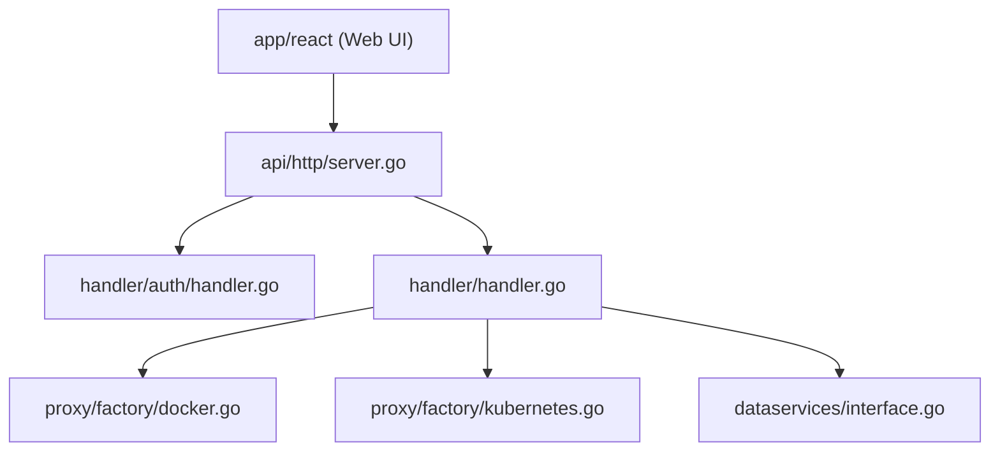

# portainer/portainer

> Web interface for managing Docker, Swarm, Podman and Kubernetes containers, for homelabs and learning.

## The problem
Managing containers and clusters from the command line is heavy for beginners or for anyone administering several environments.

## What it actually does
Web interface and API: deployment of Compose stacks and manifests, container management, registries, GitOps, backups, edge agents. Go server that relays to Docker, Kubernetes and Azure ACI.

## How it is wired

## Trying it
No command in the README: see the "Deploy Portainer" links and the documentation.

## Cost and gotchas
The Community edition is free, with no support or warranty; RBAC, SSO, audit and advanced GitOps belong to the paid Business edition (3 free nodes). 779 open issues.

## What it is not
Not intended for production according to the README. Zlib license declared, but the commercial terms of the Business offer apply outside CE.

## Alternatives
No alternative named in the README.

## For you
Worth watching: handy for a homelab or a test MLOps workstation, but the README explicitly excludes production.
