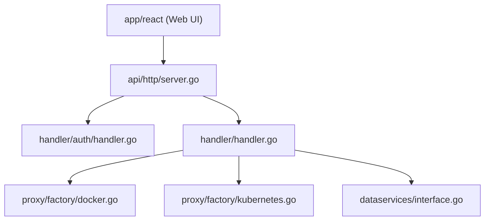

# portainer/portainer

> Interface web de gestion de conteneurs Docker, Swarm, Podman et Kubernetes, pour homelabs et apprentissage.

## Le problème
Gérer des conteneurs et des clusters en ligne de commande est lourd pour qui débute ou administre plusieurs environnements.

## Ce que ça fait vraiment
Interface web et API : déploiement de stacks Compose et manifestes, gestion de conteneurs, registres, GitOps, sauvegardes, agents edge. Serveur Go qui relaie vers Docker, Kubernetes et Azure ACI.

## Comment c'est branché

## Essayer
Aucune commande dans le README : voir les liens « Deploy Portainer » et la documentation.

## Coût et pièges
Édition Communautaire gratuite, sans support ni garantie ; RBAC, SSO, audit et GitOps avancé relèvent de l'édition Business payante (3 nœuds gratuits). 779 issues ouvertes.

## Ce que ce n'est pas
Pas destiné à la production selon le README. Licence Zlib déclarée, mais les clauses commerciales de l'offre Business s'appliquent hors CE.

## Alternatives
Aucune alternative nommée dans le README.

## Pour toi
À surveiller : pratique pour un homelab ou un poste MLOps de test, mais le README exclut explicitement la production.

