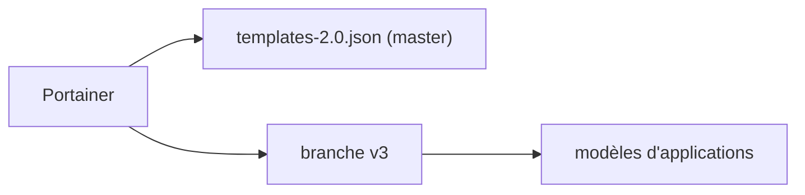

# portainer/templates

> Definitions of Portainer's official application templates, whose master branch is deprecated.

## The problem
Deploying common Docker applications from Portainer requires a list of ready-made templates.

## What it actually does
Hosts Portainer's template definitions (App Templates). The README is minimal: the master branch is deprecated, version 3 of the templates is on the `v3` branch, and version 2 remains on master (`templates-2.0.json`).

## How it is wired
Simplified diagram based on the sheet, no diagram provided.

## Trying it
No command documented.

## Cost and gotchas
No license declared in the catalog. You must pick the right branch for your Portainer version. The format details are in external documentation.

## What it is not
Not an executable tool: a set of definitions. The README's default branch is no longer the one to use.

## Alternatives
No alternative named in the README.

## For you
Ignore: only read it if you use Portainer; its content on the master branch is outdated.
