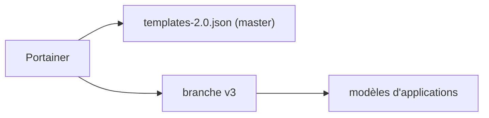

# portainer/templates

> Définitions des modèles d'applications officiels de Portainer, dont la branche master est dépréciée.

## Le problème
Déployer des applications Docker courantes depuis Portainer demande une liste de modèles prêts à l'emploi.

## Ce que ça fait vraiment
Héberge les définitions de modèles (App Templates) de Portainer. Le README est minimal : la branche master est dépréciée, la version 3 des modèles est sur la branche `v3`, et la version 2 reste sur master (`templates-2.0.json`).

## Comment c'est branché
Schéma simplifié d'après la fiche, sans diagramme fourni.

## Essayer
Aucune commande documentée.

## Coût et pièges
Aucune licence déclarée dans le catalogue. Il faut choisir la bonne branche selon la version de Portainer. Le détail du format est dans une documentation externe.

## Ce que ce n'est pas
Pas un outil exécutable : un ensemble de définitions. La branche par défaut du README n'est plus celle à utiliser.

## Alternatives
Aucune alternative nommée dans le README.

## Pour toi
Ignorer : à ne lire que si tu utilises Portainer ; son contenu sur la branche master est périmé.

