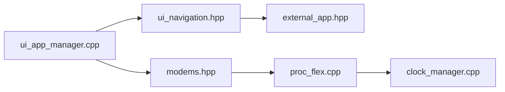

# portapack-mayhem/mayhem-firmware

> Radio application firmware for HackRF/PortaPack, for SDR enthusiasts.

## The problem
The basic HackRF + PortaPack hardware lacks applications and fixes.

## What it actually does
Fork of Havoc (itself a fork of the PortaPack firmware). Built-in and external applications: reception, transmission, analysis. Layers: application manager, UI, modems, baseband, clock, I²C bus. The README points newcomers to guides.

## How it is wired

## Trying it
No command: the README refers to the latest release page and its instructions.

## Cost and gotchas
Requires the hardware (H4M, H2...). The README warns against sellers with incompatible firmware and against paid resellers of the firmware.

## What it is not
Not PC software. H3 clones use their own firmware.

## Alternatives
No alternative cited in the README.

## For you
Ignore: embedded radio firmware, unrelated to data / AI / MLOps.
